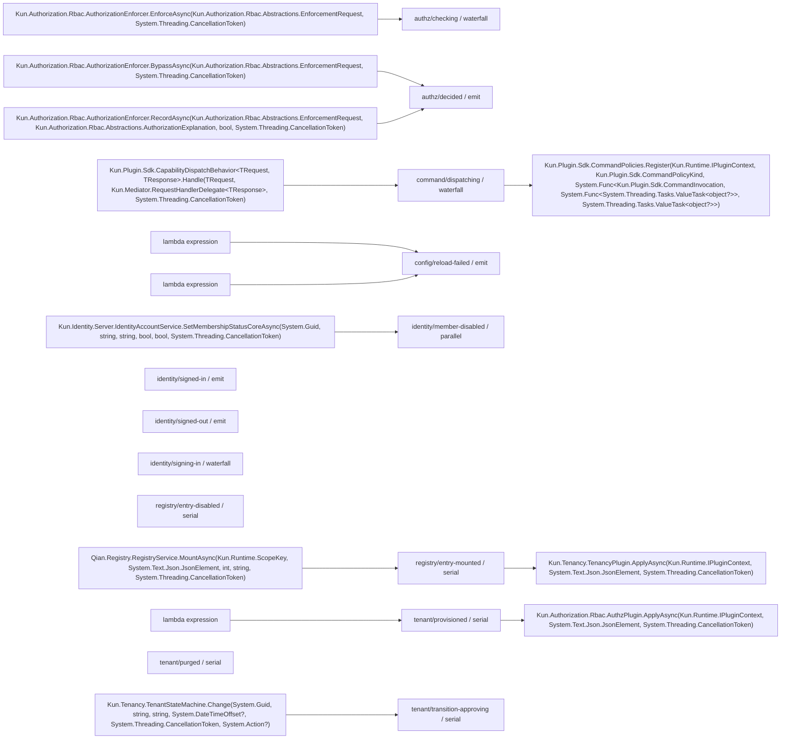

# 事件图

由 `qian docs generate` 派生；profile：` platform `。请修改输入后重新生成。

从选定 C# 源码目录的 KunEvent 定义与绑定调用派生，仅表示静态生产/消费关系；不代表当前 profile 已运行这些处理器。跨进程集成事件不在此图中。

| 事件 | 模式 | 声明位置 | 生产方 | 消费方 |
|---|---|---|---|---|
| ` authz/checking ` | ` waterfall ` | ` Kun.Authorization.Rbac.Abstractions.AuthzRuntimeEvents.Checking `（` src/Kun.Authorization.Rbac.Abstractions/AuthzEnforcement.cs `:114） | ` Kun.Authorization.Rbac.AuthorizationEnforcer.EnforceAsync(Kun.Authorization.Rbac.Abstractions.EnforcementRequest, System.Threading.CancellationToken) `（` src/Kun.Authorization.Rbac/AuthorizationEnforcer.cs `:44） |  |
| ` authz/decided ` | ` emit ` | ` Kun.Authorization.Rbac.Abstractions.AuthzRuntimeEvents.Decided `（` src/Kun.Authorization.Rbac.Abstractions/AuthzEnforcement.cs `:118） | ` Kun.Authorization.Rbac.AuthorizationEnforcer.BypassAsync(Kun.Authorization.Rbac.Abstractions.EnforcementRequest, System.Threading.CancellationToken) `（` src/Kun.Authorization.Rbac/AuthorizationEnforcer.cs `:82） ` Kun.Authorization.Rbac.AuthorizationEnforcer.RecordAsync(Kun.Authorization.Rbac.Abstractions.EnforcementRequest, Kun.Authorization.Rbac.Abstractions.AuthorizationExplanation, bool, System.Threading.CancellationToken) `（` src/Kun.Authorization.Rbac/AuthorizationEnforcer.cs `:108） |  |
| ` command/dispatching ` | ` waterfall ` | ` Kun.Plugin.Sdk.CommandEvents.Dispatching `（` src/Kun.Plugin.Sdk/Commands.cs `:20） | ` Kun.Plugin.Sdk.CapabilityDispatchBehavior<TRequest, TResponse>.Handle(TRequest, Kun.Mediator.RequestHandlerDelegate<TResponse>, System.Threading.CancellationToken) `（` src/Kun.Plugin.Sdk.Commands/CommandPipeline.cs `:195） | ` Kun.Plugin.Sdk.CommandPolicies.Register(Kun.Runtime.IPluginContext, Kun.Plugin.Sdk.CommandPolicyKind, System.Func<Kun.Plugin.Sdk.CommandInvocation, System.Func<System.Threading.Tasks.ValueTask<object?>>, System.Threading.Tasks.ValueTask<object?>>) `（` src/Kun.Plugin.Sdk/CommandPolicies.cs `:34） |
| ` config/reload-failed ` | ` emit ` | ` Kun.Configuration.ConfigRuntimeEvents.ReloadFailed `（` src/Kun.Configuration.Abstractions/ConfigEvents.cs `:24） | ` lambda expression `（` src/Kun.Configuration.Platform/ConfigurationPlugins.cs `:34） ` lambda expression `（` src/Kun.Configuration.Platform/ConfigurationPlugins.cs `:62） |  |
| ` identity/member-disabled ` | ` parallel ` | ` Kun.Identity.Abstractions.IdentityRuntimeEvents.MemberDisabled `（` src/Kun.Identity.Abstractions/IdentityEvents.cs `:122） | ` Kun.Identity.Server.IdentityAccountService.SetMembershipStatusCoreAsync(System.Guid, string, string, bool, bool, System.Threading.CancellationToken) `（` src/Kun.Identity.Server/IdentityAccountService.Accounts.cs `:413） |  |
| ` identity/signed-in ` | ` emit ` | ` Kun.Identity.Abstractions.IdentityRuntimeEvents.SignedIn `（` src/Kun.Identity.Abstractions/IdentityEvents.cs `:116） |  |  |
| ` identity/signed-out ` | ` emit ` | ` Kun.Identity.Abstractions.IdentityRuntimeEvents.SignedOut `（` src/Kun.Identity.Abstractions/IdentityEvents.cs `:119） |  |  |
| ` identity/signing-in ` | ` waterfall ` | ` Kun.Identity.Abstractions.IdentityRuntimeEvents.SigningIn `（` src/Kun.Identity.Abstractions/IdentityEvents.cs `:113） |  |  |
| ` registry/entry-disabled ` | ` serial ` | ` Qian.Surfaces.Abstractions.SurfaceHookEvents.EntryDisabled `（` _import/qian/packages/Qian.Surfaces.Abstractions/HookContracts.cs `:51） |  |  |
| ` registry/entry-mounted ` | ` serial ` | ` Qian.Surfaces.Abstractions.SurfaceHookEvents.EntryMounted `（` _import/qian/packages/Qian.Surfaces.Abstractions/HookContracts.cs `:49） | ` Qian.Registry.RegistryService.MountAsync(Kun.Runtime.ScopeKey, System.Text.Json.JsonElement, int, string, System.Threading.CancellationToken) `（` _import/qian/packages/Qian.Registry/RegistryService.cs `:174） | ` Kun.Tenancy.TenancyPlugin.ApplyAsync(Kun.Runtime.IPluginContext, System.Text.Json.JsonElement, System.Threading.CancellationToken) `（` src/Kun.Tenancy/TenancyPlugin.cs `:33） |
| ` tenant/provisioned ` | ` serial ` | ` Qian.Surfaces.Abstractions.SurfaceHookEvents.TenantProvisioned `（` _import/qian/packages/Qian.Surfaces.Abstractions/HookContracts.cs `:45） | ` lambda expression `（` src/Kun.Tenancy/TenantProvisioningOrchestrator.cs `:116） | ` Kun.Authorization.Rbac.AuthzPlugin.ApplyAsync(Kun.Runtime.IPluginContext, System.Text.Json.JsonElement, System.Threading.CancellationToken) `（` src/Kun.Authorization.Rbac/AuthzPlugin.cs `:96） |
| ` tenant/purged ` | ` serial ` | ` Qian.Surfaces.Abstractions.SurfaceHookEvents.TenantPurged `（` _import/qian/packages/Qian.Surfaces.Abstractions/HookContracts.cs `:47） |  |  |
| ` tenant/transition-approving ` | ` serial ` | ` Kun.Tenancy.TenantLifecycle.Approving `（` src/Kun.Tenancy.Abstractions/StateMachine.cs `:13） | ` Kun.Tenancy.TenantStateMachine.Change(System.Guid, string, string, System.DateTimeOffset?, System.Threading.CancellationToken, System.Action?) `（` src/Kun.Tenancy/TenantStateMachine.cs `:59） |  |

## 校验诊断

- warning：` _import/qian/packages/Qian.Surfaces.Hosting/HookBridgePlugin.cs `:32，事件来自动态参数或外部二进制，未能静态解析；此调用不计入已验证映射。
- warning：` src/Kun.Runtime/Contracts.cs `:93，事件来自动态参数或外部二进制，未能静态解析；此调用不计入已验证映射。
- warning：` src/Kun.Runtime/Contracts.cs `:97，事件来自动态参数或外部二进制，未能静态解析；此调用不计入已验证映射。
- warning：` src/Kun.Runtime/PluginContext.Events.cs `:51，事件来自动态参数或外部二进制，未能静态解析；此调用不计入已验证映射。
