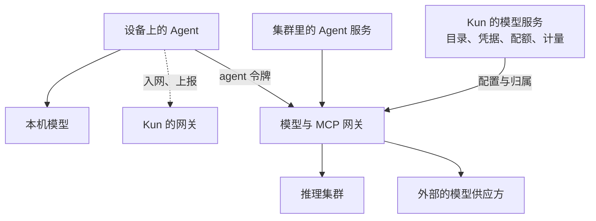

# 对智能体的支撑：Agent 接入与模型服务

> 状态：规划稿（2026-11-17，2026-11-19 补）。已定的见第 1 节，其余是提议，待产品负责人确认。「已有」指在原仓库里已经实现。
>
> 2026-11-19 补：人审的两道关口与路线的里程碑已定（[2026-11-19 平台级裁定](https://github.com/CavaiLAB/jiangxin/blob/main/docs/decisions/2026-11-19-platform.md) P28、P31），见第 1、3 节。
>
> 2026-11-24 补：SanYuanAgent 暂缓开发，现在使用 DSH；设备上的本机模型只定了先后，等设备一侧用什么运行时定下来再定，排在路线里程碑 M8 之前（已定，[S1-DEC-038](../pm/tasks/S1-DEC-038.md) D45、D48）。第 1 节第 1 条据此加注。
>
> 本文只写 Kun 这一侧要提供什么。引擎一侧怎么用，见 SanYuanAgent 的[接入平台：与 Kun 的交互](https://github.com/CavaiLAB/sanyuan-agent/blob/main/docs/platform.md)与[与模型服务的交互](https://github.com/CavaiLAB/sanyuan-agent/blob/main/docs/models.md)。

## 1 已定

产品负责人 2026-11-17 的裁定：

1. SanYuanAgent 是独立运行的 SDK。每个端都要用到它，包括机器人这类边缘设备，装上就能用。（2026-11-24 起 SanYuanAgent 暂缓开发，现在使用 DSH，S1-DEC-038 D45。）
2. 模型服务由 Kun 提供；机器人这类设备本地可能还有小模型。

对 Kun 来说这意味着两件事：

- 智能体不只跑在集群里。Kun 要接得住从设备上连进来的 Agent。
- 模型服务是 Kun 的一项平台能力，不再只是平台之外的一个组件。

2026-11-19 的平台级裁定里与本文有关的两条（[2026-11-19 平台级裁定](https://github.com/CavaiLAB/jiangxin/blob/main/docs/decisions/2026-11-19-platform.md)）：

3. 每个 Agent 发出去的内容都要由人审核，发给 Agent 的内容也是；起步出站、入站两道都必审。「发出去」包括发给别的 Agent、发给别人、写外部系统三类。（P28）
4. 路线重排，最小的一圈提前。里程碑的顺序见平台总览的[路线与迁移](https://github.com/CavaiLAB/jiangxin/blob/main/docs/06-roadmap.md)第 2.1 节；与本文有关的是：M1 启用智能体主体，能力目录给 Agent 用，先只读；M2 加写类能力与对话里的确认卡；M7 是协同与人审；M8 是设备接入。（P31）

对 Kun 来说，`agent` 主体与委托链、把能力目录派生成工具不再排在最后，要在 M1 先打通；协同服务的审核流程要管出站、入站两道；设备一侧的接口随 M8。

## 2 两种接入方

| | 集群里的 Agent 服务 | 设备上的 Agent |
|---|---|---|
| 在哪里 | 和 Kun 在同一个集群 | 工站、产线的设备上，在车间网络里 |
| 怎么进来 | 网关把请求转交给它，带内部短期令牌 | 设备向外连到平台的入口，带 `agent` 令牌 |
| 在不在线 | 一直在线 | 可能断网 |
| 身份 | 一个进程服务很多个 `agent` 主体，每次运行按令牌切换 | 一台设备入网之后是一个 `agent` 主体 |

两种接入方用同一组接口，判定规则也相同。Kun 不需要能连到设备：连接都由设备发起。

## 3 Kun 要提供的接口

| 接口 | 做什么 | 现状 |
|---|---|---|
| 设备入网 | 受理入网申请，人批准之后签发设备凭据；吊销 | 没有；设备接入排在里程碑 M8 |
| 令牌 | 用设备凭据换短期的 `agent` 令牌，带委托链 | 契约已冻结；`agent` 主体还没有启用。主体排在里程碑 M1，设备换令牌随 M8 |
| 能力工具 | 把能力目录按范围派生成 MCP 工具，供远程调用。按现行的决策，它们挂在模型与 MCP 网关的 MCP 路由后面 | 规划；排在 M1，先只读 |
| 下发 Agent 表面 | 插件树里属于这个 Agent 范围的技能、子 Agent、钩子、MCP 声明，带签名 | 插件树与范围过滤已有；下发的接口是规划 |
| 下发策略 | 工具策略、模型路由策略、断网时允许做什么 | 规划 |
| 接收上报 | 设备上的审计事件、用量、运行事件、心跳；按序号补传与去重 | 审计链已有；接收设备的补传是规划 |
| 协同 | 信箱、线程、审核流程。出站确认、入站审核两道，起步都必审（已定） | 规划；排在 M7 |
| 模型服务 | 见第 6 节 | 规划 |
| 让模型与 MCP 网关认得 `agent` 令牌 | 设备是不可信的调用方，调用归到谁要从校验过的令牌里取 | 没有。现行的决策在第一阶段不把身份校验交给这个网关 |

这些接口都在平台档。内核档不加 AI 语义。

## 4 入网、设备凭据与常设委托

- **入网。** 设备在本机生成密钥对，带着公钥来申请，得到一个入网码。将要成为主人的人在界面上核对入网码，确认这台设备上跑的是哪个 Agent、授多大的范围。谁批准，谁就是主人：Agent 用的是主人的权限，不能由别人替他指定。团队 Agent 由团队指定的负责人批准。批准之后设备拿到凭据。
- **设备凭据。** 一台设备一份，绑定它的公钥，可以单独吊销。私钥不出设备，平台不保存。
- **令牌。** 设备用私钥证明自己，换一个短期的 `agent` 令牌。令牌按受众签发，不透传。业务接口这条路上，外部令牌照旧只到 Kun 的网关，网关校验之后换发内部短期令牌，里面带租户、主体类型、权限范围与委托链。
- **常设委托。** 设备上没有人坐在旁边发起请求。委托在入网时由主人批准一次，之后每次换令牌都按这份委托写委托链。主人被停用或者委托被撤回，就不再签发。拒绝要给得明确：设备靠它分清「被吊销」和「连不上」，前者要立即停下，后者按断网处理。
- **定义与主体分开。** 同一份 Agent 定义可以装到很多台设备上，每台设备入网之后各是一个独立的 `agent` 主体，各有审计记录。Agent 目录里要看得到每个主体跑在哪台设备上、在不在线、什么版本。

提议入网和换令牌沿用现成的标准流程，不另外发明。身份服务用的框架对这些流程支持到什么程度，实现时核对。

## 5 设备接入带来的新问题

| 问题 | 说明 |
|---|---|
| 设备自述的审计 | 设备补传的审计事件来得晚，又是设备自己说的，不是 Kun 亲自记下的。它们要和 Kun 的审计链分得开，核验时知道哪些是自述 |
| 下发内容的签名 | 设备要在断网时校验缓存的策略与技能，所以 Kun 下发的内容要带签名，验签用的公钥在入网时交给设备 |
| 时钟 | 设备的时钟不一定准。补传的事件带设备的时间与序号，Kun 另记收到的时间 |
| 吊销的时延 | 吊销靠的是不再续令牌。断着网的设备收不到拒绝，会按缓存的策略干到宽限期结束。宽限期就是吊销对它生效的最长延迟，定宽限期的时候要把这一点算进去 |
| 长连接 | 每台在线的设备保持一条向外的连接。连接数随设备数增长，容量要单独估 |
| 入口对设备开放 | 网关现在面对的是浏览器与服务。设备进来之后多了一类调用方，它的入口、证书与网络路径怎么布置，部署时定 |

## 6 模型服务

模型服务由 Kun 提供（已定）。照原仓库已有的决策，它分成两部分：

| 部分 | 做什么 | 由谁承担 |
|---|---|---|
| 控制面 | 模型目录、逻辑模型名、调用凭据、路由策略、配额、计量的归属 | Kun 的一个平台组件 |
| 数据面 | 转发模型请求、限流、统计 | 模型与 MCP 网关，外部组件；后面是推理集群与外部的模型供应方 |

Kun 不自己写模型代理，转发仍由模型网关承担。这是原仓库里已有的决策，这里不改。

模型服务提供的东西：

| 内容 | 说明 |
|---|---|
| 模型目录 | 每个模型的能力描述：模态、是否支持工具调用、上下文长度、数据驻留、时延与成本的档位。逻辑名按用途分槽位，调用方不写死具体模型 |
| 调用入口 | 兼容 OpenAI 的接口。先做对话与嵌入 |
| 租户路由 | 产品默认加租户覆盖。配置坏了回落到默认 |
| 配额与计量 | 按租户、应用、Agent 计量，设预算与熔断 |
| 密钥 | 模型供应方的密钥只以引用出现，不下发给调用方 |

现状：方向已经由原仓库的决策记录定下，组件还只有骨架。模型目录与先行的调用路径排在原仓库的近期任务里，计量与限流排在其后。

另外，Agent 引擎的服务层里现在有一套兼容 OpenAI 的接口，带按租户的调用密钥、配额与用量归属。模型服务由 Kun 提供之后，这一套怎么并过来，待定。

## 7 设备与本机模型

**设备调用平台的模型。** 按现行的网关分层，模型与 MCP 流量走模型与 MCP 网关，不经 Kun 的网关。提议照此不变，设备带 `agent` 令牌直接调它：

- 设备上不用放长期有效的模型密钥。
- 调用归到哪个租户、哪个 Agent，从校验过的令牌里取，不听设备自己报。集群里的服务是可信的调用方，归属照旧由它自己标注。
- 这要求模型与 MCP 网关能校验 Kun 签发的令牌。现行的决策只说了第一阶段不把身份校验交给它；到 `agent` 主体启用的时候，这一条要重新定。路线把主体排在里程碑 M1，设备接入排在 M8。

另一种做法是让设备的调用都经 Kun 的网关转交。设备一侧只有一条路，但业务网关就承载了模型流量，和现行的网关分层决策有出入；计量要从响应里取用量，转交的这一跳也免不了要读响应。

**设备上的本机模型。** 它不经过模型网关。提议 Kun 做三件事：

- 目录里登记每台设备报上来的本机模型，看得到哪台设备上有什么。
- 接收引擎上报的本机用量，和平台自己计的分开记。
- 在路由策略里写明什么时候用本机模型。

这和现行的决策有出入。现行决策不许应用绕开模型网关直连模型，为的是统一计量与隔离。设备上的本机模型过不了网关，要把它登记成一条明确的例外：只限设备本机地址上的模型。

## 8 待定

| 事项 | 提议 |
|---|---|
| 设备调用平台的模型与能力走哪条路 | 照现行的网关分层走模型与 MCP 网关，并让它认得 `agent` 令牌，见第 7 节 |
| 本机模型作为「模型调用都过模型网关」的例外 | 登记为例外，并回写到原仓库的决策记录 |
| 设备上的 Agent 归谁 | 归批准它入网的人，一般是这台设备的负责人。允许团队 Agent 的话归班组，由班组指定的负责人批准 |
| 入网是否逐台由人批准 | 起步逐台批准 |
| 设备自述的审计怎么存 | 没有提议。要和 Kun 的审计链分得开 |
| 边缘节点上跑不跑 Kun、跑哪个 profile | 没有提议。它决定设备是接云上的 Kun 还是就近接产线的节点 |
| 模型服务先提供哪几类模型 | 先对话与嵌入；语音、重排、视觉按需再加 |
| 本机模型由谁装、谁管版本 | 起步随设备预装；由平台下发另行设计 |
| 引擎服务层里现有的兼容 OpenAI 的接口与模型治理怎么并到 Kun | 提议模型目录、租户覆盖、调用密钥、配额与用量账归 Kun 的模型服务；引擎保留按目录路由与回退 |
