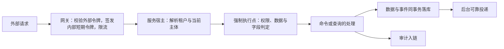

# Kun 框架架构

> 状态：规划稿（2026-11-17）。本文描述归并之后的 Kun，依据是合并蓝图（本仓库里的 `_import/qian/docs/adr/ADR-023-kun-qian-merge-blueprint.md`，2026-11-17 接受）。「已有」指在原仓库里已经实现。
>
> 2026-11-19 补：加一种 Agent 一级的范围、人审两道、`agent` 主体在路线的里程碑 M1 启用（已定，[2026-11-19 平台级裁定](https://github.com/CavaiLAB/jiangxin/blob/main/docs/decisions/2026-11-19-platform.md) P29、P28、P31），见第 3、8 节。这批裁定与过渡目录里决策记录的出入登记在 `_import/qian/pm/tasks/S1-DEC-038.md`（D22–D26），决策记录的原文没有改。

## 1 边界

Kun 负责后端的一切平台能力，以及对智能体的支撑。它不负责三件事：

- 不写智能体的推理循环，由 SanYuanAgent 负责。
- 不做界面，由 Qian 负责。
- 不规定业务。业务功能是装在 Kun 上的组件。

## 2 两档分层

| 档位 | 判据 | 规则 |
|---|---|---|
| 内核档 | 通用机制：错误模型、命令与查询调度、租户上下文、事件总线、数据访问约定、令牌校验、网关、存储后端、配置源。它不知道租户目录、人员、角色、组件清单这些产品概念 | 可以在任意 .NET 10 应用里单独安装使用；不得引用平台档的包 |
| 平台档 | 带产品语义：租户主档与开通、身份服务、权限引擎、文件服务、能力目录、注册表、生命周期、调度 | 以组件形式装配；只依赖内核档与别的平台组件的契约包，不依赖别的平台组件的实现包 |

- 每个包的档位和角色写在项目属性里，依赖门禁按这张显式的表检查，不再按包名前缀猜。
- 只用内核的项目和原生发布的网关不会被平台档拖累。
- 合并之后共 84 个包：内核档 40 个，平台档 44 个。

## 3 运行时模型

- **上下文。** 组件与外界打交道的唯一入口：服务注册表、事件、副作用栈、当前范围。
- **依赖声明与装配。** 组件声明自己依赖哪些服务键；依赖全部就绪才启动，装载顺序由依赖关系决定，不靠手工编排。
- **注册即副作用，副作用可撤销。** 提供服务、监听事件、登记工具都是副作用。卸载、重载时按注册的相反顺序撤销。
- **事件就是扩展点。** 五种分发方式：观察、环绕、并行、按序、取首个返回值。每个事件在定义处标明方式，CI 检查定义与调用点一致。
- **范围。** 一项注册要么是全局的，要么只属于一个范围：租户、应用或 Agent 会话。范围内的注册遮蔽同名的全局项；被过滤掉的项和不存在没有区别。另加一种 Agent 一级的范围（已定，2026-11-19），用来给某个 Agent 长期挂组件；它还没有进规格，与另外三种范围怎么叠，待定，见平台总览的[一切皆插件](https://github.com/CavaiLAB/jiangxin/blob/main/docs/03-plugin-model.md)第 9 节。
- **运行时不带业务语义。** 它只认服务键、事件定义和范围。租户校验、权限判定、审计这些强制执行点，是基础组合包里的环绕式监听器。

## 4 包的形态与命名

一项能力拆成三个角色，适用于平台档：

| 角色 | 内容 | 依赖规则 |
|---|---|---|
| 契约 | 服务键、接口、词汇类型、事件定义、错误码；没有实现 | 只依赖运行时和别的契约包 |
| 提供方 | 组件实现、数据迁移、组件文件夹 | 可以依赖契约包和内核档；不依赖别的平台组件的实现 |
| 消费方 | 只经接口调用 | 不依赖任何提供方 |

命名规则（蓝图，已接受）：

- 一个职责一个名字根。例如配置用 `Configuration`，事件用 `EventBus`，权限用 `Authorization`。
- 后缀表明角色：`.Abstractions` 是契约，无后缀是缺省实现，`.AspNetCore` 是 HTTP 适配，按技术命名的提供方用技术名。
- 上下两层各用各的名字：`Kun.MultiTenancy` 回答「当前请求是哪个租户」，`Kun.Tenancy` 回答「有哪些租户、什么状态」；`Kun.Storage.*` 是存储后端，`Kun.Files.*` 是带配额与策略的文件服务。
- 组件 id 与包名脱钩。组件 id 保持 `qian.<名字>` 不变，清单里显式列出它对应的包。

## 5 请求怎么走

- 外部令牌只到网关。网关之后只用内部短期令牌，里面带租户、主体类型、角色与权限范围。
- 租户上下文只来自令牌，缺失即拒绝。租户号统一用 Guid，租户上下文端口里的属性类型也是 Guid（已定，在数据域归并时落地）。
- 没有声明权限的入口，强制执行点不放行。
- 业务数据和要发的事件在同一个事务里落库，投递由后台完成，消费端按事件标识去重。
- 审计记录与业务同事务，按哈希链串联。
- 出错时返回结构化错误：稳定的错误码加机器可读的细节。

## 6 能力域与合并后的包

下表是蓝图里的归并对照的摘要，只列每个域的主要包。档位在各批归并开工时按依赖图再核一遍。

| 域 | 内核档 | 平台档 |
|---|---|---|
| 运行时基础与错误模型 | `Kun.Errors`、`Kun.Core`、`Kun.Mediator`、`Kun.Validation`、`Kun.AspNetCore`、`Kun.Runtime`、`Kun.Plugin.Sdk`、`Kun.Caching`、`Kun.Observability` | `Kun.Plugin.Sdk` 的命令管道与 HTTP 适配 |
| 数据与租户 | `Kun.MultiTenancy`、`Kun.EntityFrameworkCore`、原生数据通道 | `Kun.Data`、`Kun.Tenancy`、`Kun.Tenancy.Signup` |
| 权限 | `Kun.Authorization`（端口） | `Kun.Authorization.Rbac`、`Kun.Authorization.AspNetCore` |
| 身份、安全、网关 | `Kun.Security`、`Kun.Identity`、`Kun.Gateway`、`Kun.RateLimit`、`Kun.Grpc` | `Kun.Identity.Server`、`Kun.Identity.Client`、身份连接器 |
| 事件与审计 | `Kun.EventBus` 及其数据库与 RabbitMQ 包、审计的契约与原生实现 | `Kun.Audit.EntityFrameworkCore` |
| 配置 | `Kun.Configuration`、`Kun.Configuration.Apollo`、`Kun.Configuration.Secrets` | `Kun.Configuration.Platform` |
| 存储与文件 | `Kun.Storage.*` | `Kun.Files` |
| 生命周期与调度 | — | `Kun.Lifecycle`、`Kun.Scheduler` |
| 平台组件 | — | `Kun.Capabilities`、`Kun.Registry`、`Kun.Surfaces`、`Kun.Profiles`、`Kun.Docs` |
| 测试支持 | `Kun.Testing`、`Kun.Testing.Containers` | — |

两边各有一套实现的地方，留哪一套看谁在用、谁有测试：

- 留仓库根上 Kun 框架的：身份协议客户端与会话存储、存储后端、令牌签发、命令与查询调度、缓存。
- 留 `_import/qian/` 下平台代码的：错误模型、审计链、事件的投递循环、消息的发布与订阅、权限的强制执行点。

归档的模块有五个：`Kun.Saga`、`Kun.Sandbox`、`Kun.Dapper`、`Kun.Infrastructure`、旧线的 `Kun.Storage`（已定）。归档指移出解决方案和发版清单，源码留在历史里，已经发布的版本不动。

## 7 profile 与可部署单元

一个 profile 是一份具名的组件组装，也是一个可部署单元。现有五个：

| profile | 用途 |
|---|---|
| `platform` | 平台服务：全部平台组件 |
| `gateway` | 网关 |
| `identity` | 身份服务 |
| `standalone` | 单进程形态：一个进程装下需要的能力 |
| `minimal` | 最小组装：只有运行时和声明式表面的装载器，其余按需加 |

运行中的 Kun 是一棵插件树，由几层按顺序叠出来：profile 列出的组合包、profile 自己的补丁、本机补丁、命令行补丁，运行中再叠上存在数据库里的租户补丁。整棵树可以一条命令打印出来，其中任何条目都能被补丁替换。新增一个可部署单元，就是新增一个 profile 文件。

## 8 对智能体的支撑

| 能力 | 说明 | 现状 |
|---|---|---|
| 三类主体与委托链 | `user`、`service`、`agent`。Agent 的有效权限 = 委托人的权限 ∩ 授给它的范围 | 契约已冻结；`agent` 主体与委托链还没有启用，排在路线的里程碑 M1 |
| 能力目录 | 每项能力登记输入输出 Schema、副作用等级、所需权限、数据分级、是否对 Agent 暴露 | 已有 |
| 只许人做 | 标了的能力不对 Agent 暴露，Agent 主体调用即被拒绝 | 字段已有；强制执行随 `agent` 主体启用 |
| 范围过滤 | 按租户、应用、Agent 会话收窄看得到的工具与能力 | 已有。Agent 一级的范围已定要加，还没有进规格 |
| 把能力目录暴露成工具 | 按范围把能力目录派生成 MCP 工具 | 规划；排在里程碑 M1，先只读 |
| Agent 归属与目录 | Agent 归到人，登记名片 | 规划 |
| 协同服务 | 信箱、线程、审核流程与策略、限定范围的授权。出站确认、入站审核两道，起步都必审（已定） | 规划，排在里程碑 M7；放在 Kun 是提议，见 [Agent 协同](https://github.com/CavaiLAB/jiangxin/blob/main/docs/04-agent-collaboration.md) |
| 智能体生成的变更 | 智能体提交草稿组件或补丁，经校验、预览、人工批准后发布，可回滚 | 规划 |
| 计量与预算 | 按租户、应用、Agent 计量模型调用，设预算与熔断 | 规划 |
| Agent 接入 | 设备入网与设备凭据；向设备下发 Agent 表面与策略；接收设备上报的审计与用量 | 规划，做法是提议 |
| 模型服务 | 模型目录、调用入口、租户路由、配额与计量；模型请求的转发由模型网关承担 | 由 Kun 提供是已定的；实现是规划 |

Agent 相关的表面与能力目录在平台档，内核档不加 AI 语义。

2026-11-17 已定：SanYuanAgent 是独立运行的 SDK，每个端都要用到它，包括机器人这类边缘设备；模型服务由 Kun 提供，设备本地可能还有小模型。所以智能体不只跑在集群里，Kun 要接得住从设备上连进来的 Agent。最后两行的展开见[对智能体的支撑：Agent 接入与模型服务](agent-support.md)。

## 9 AOT 口径

AOT 与档位无关。缺省不声明，逐个项目显式打开；一个项目是否兼容，以宿主原生发布并运行的冒烟测试为准，不以标记为准。网关的生产宿主已经按原生方式发布。

## 10 待确认

蓝图本身已接受，原来待确认的十条都已确认。下面是分仓库之后对它的修订，已登记，待产品负责人确认：

- 蓝图按一个仓库写了目标目录布局。现在前端单独一个仓库。TypeScript 运行时与前端插件开发包提议随前端仓库；命令行与声明式表面的校验库不依赖任何前端包，提议留在本仓库；平台组件自带的界面放哪里，待定。
- 合并后的仓库改为本仓库，取代蓝图里写的目标仓库，平台档私有包源的所有者随之改变。

逐项见[迁移与归并](migration.md)第 6 节。
