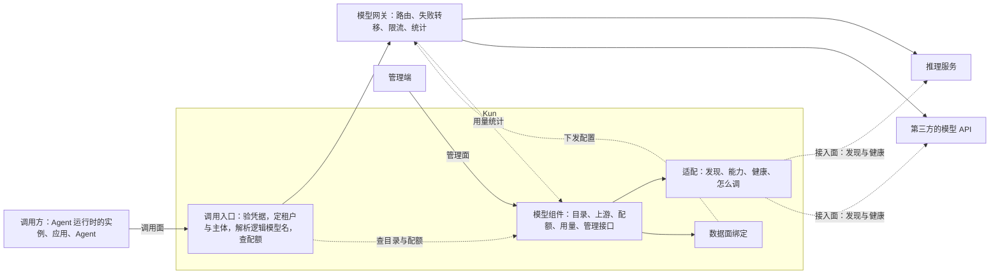

# 模型服务的标准接口：契约草案（提议）

把模型服务的标准接口从提纲写成契约草案：接口分调用、接入、管理三个面，每个面是什么形状，两种形态各装什么，和现行决策怎么对齐，哪些问题要产品负责人定。全文是提议，没有实现。

| 项 | 值 |
|---|---|
| 状态 | 提议，待产品负责人裁定 |
| 日期 | 2026-11-26 |
| 跟踪 | 草案本身是 [S1-MGW-004](../../pm/tasks/S1-MGW-004.md)；要裁定的九个问题是 [S1-DEC-044](../../pm/tasks/S1-DEC-044.md) |
| 依据 | 平台级裁定 P14（本仓库登记在 [S1-DEC-038](../../pm/tasks/S1-DEC-038.md) D11）、P83（[S1-DEC-043](../../pm/tasks/S1-DEC-043.md) D5）；[ADR-015](../adr/ADR-015-model-gateway.md)；[ADR-010](../adr/ADR-010-gateway-layers.md)；[组件模型规格](../prd/specs/component-model.md) |
| 本文不做的事 | 不写实现；不改 ADR 与需求文档的原文；不动冻结的契约；不改现有任务的内容；不替产品负责人定第 11 节的任何一个问题 |

本文的标法：

- **已定**：产品负责人裁定过的，或本仓库已接受的决策记录里写着的。
- **读法**：登记裁定时整理者的读法，产品负责人没有逐句确认。
- **提议**：本文提出的做法，没有裁定。第 1.1 节、第 4.4 节和第 5 节到第 9 节通篇是提议，不逐句再标；第 10、11 节里的建议也是。
- **没有定**：要产品负责人定的，集中在第 11 节。
- 说现状时写「已有」（仓库里有代码）或「规划」（只有文档，没有代码）。

本文说的「模型网关」，指 ADR-015 里承担模型请求转发的那个现成的网关；「推理服务」指集群里自己管的模型推理与它的管理服务。两者现行的选型写在 ADR-015 里，本文不重复名字。

## 1 一页看完

### 1.1 草案的要点

1. 接口分三个面。调用面给调用方用：一组 OpenAI 兼容的 HTTP 端点，调用方只认平台的地址、平台发的凭据和逻辑模型名。接入面给模型后端的适配用：一组 .NET 接口，加清单里的一条声明。管理面给管理端用：一组 HTTP 接口，加权限点。
2. 两种形态的差别只落在接入面：装哪个适配，登记哪些上游。调用面与管理面两种形态一样。
3. 适配是代码，上游是数据。接一类新的模型后端，写一个适配组件；同一类后端再加一个地址，只是在管理端里登记一个上游，前提是这个地址已经在出网名单里。
4. 适配不转发模型请求。它回答四件事：有哪些模型，各自能做什么，是否健康，怎么调。「怎么调」是一份给数据面的描述，转发仍由现成的模型网关做，与 ADR-015 的「不自己写模型代理」一致。自己管推理的后端多实现一个可选的接口：部署、扩缩与下线。
5. 调用面前面有一个调用入口：验平台发的凭据，定租户与主体，解析逻辑模型名，查配额，写上计量的标签，再转给数据面。租户、配额、计量留在平台一侧。入口落在哪一层有两种放法，各自至少要改 ADR-010 的一条；草案照「放在 Kun 的网关上」写，这时模型网关仍然不知道租户，与 ADR-015 的 D15.4、D15.6 一致（问题 9）。
6. 模型的能力用一份机器可读的描述来声明：类型、输入输出的模态、上下文长度、几个能力开关。答不上来的写「不知道」，与「不支持」分开记。同一份描述出现在三处：适配的返回，管理端的目录，调用面的模型列表。
7. 管理面的每个操作对应一个权限点，判定走 Kun 的鉴权，模型服务不自己判权限（P86 的读法）。「谁能调模型」也是一个权限点，在签发调用方凭据时判。

### 1.2 与现行决策的出入

详见第 10 节。最要紧的六条：

- 多出来两样：验平台凭据的调用入口，调用方凭据的签发。ADR-015 的 D15.3 说本仓库一侧只做三件事：上游登记、适配、模型目录；其中的上游登记，草案写成了数据面绑定。
- 模型请求从哪里进。现行的写法是所有客户端只对接模型网关，模型流量不经 Kun 的网关（ADR-010 D10.1、D10.10）。调用入口放在 Kun 的网关上，或者放在模型网关上，都至少要改其中一条（问题 9）。
- 适配从「一个服务，对接一种推理服务」改成一个注册表上的多个适配组件。现行的三个任务是照一种推理服务写的。
- 两份能力契约，ADR-015 写的是直接用下游的，本仓库里没有这两个文件。草案给了自己的形状。
- 调用面的错误体跟公开协议走，不是本仓库统一的错误模型。管理面仍然用统一的错误模型。
- 已定的「统一由管理端管理」，与现行验收里的「模型网关的配置变更全部经部署仓库评审」、ADR-015 D15.2 的「逻辑模型名的映射入库」，之间要有一个说法（问题 6）。

### 1.3 要产品负责人定的九个问题

选项与影响见第 11 节。建议是整理者的，不是结论。

| # | 问题 | 建议 |
|---|---|---|
| 1 | 不带模型推理的形态，模型请求也过模型网关吗？ | 集群上的部署都过；单机版等它的装配清单定了再答 |
| 2 | 计量与配额第一版做到哪一步？ | 记用量，加每分钟的限流；月度配额与金额放后面 |
| 3 | 第三方模型服务的凭据由平台统一配，还是允许租户自带？ | 第一版由平台统一配；契约按「租户可以自带」留好 |
| 4 | 「可以参考框架」指的是哪一个？ | 请他点名；没有特指，就照本文第 4 节归纳的做法 |
| 5 | 调用方的凭据发到哪一级：每个租户一把，还是落到人和应用头上？ | 落到人和应用头上 |
| 6 | 管理端里改模型的配置，是点了就生效，还是经变更评审后生效？ | 分两类：不改流量出口的点了就生效，改流量出口的经评审 |
| 7 | 带推理的形态，管理端对推理服务管到哪一步：只看，能上下线，还是也能部署与扩缩？ | 第一版做到上下线；部署与扩缩的接口留好 |
| 8 | 调用面第一版只做 OpenAI 兼容的对话、嵌入与模型列表，其余按需再加，可以吗？ | 可以；要提前加一样，先加重排 |
| 9 | 平台发的调用方凭据在哪一层验：模型请求先过 Kun 的网关，还是由模型网关自己验？ | 先过 Kun 的网关；先做一次验证，不过再改 |

问题 9 只在问题 5 答「落到人和应用头上」时才有。

## 2 依据

### 2.1 已定

- 模型服务由 Kun 提供；机器人这类设备本地可能还有小模型（P14，本仓库登记为 S1-DEC-038 D11）。
- 产品负责人 2026-11-26 的原话（P83，本仓库登记为 S1-DEC-043 D5）：「企业级框架分为两种 1.K8s集群，包括模型推理服务， GPU Stack 等 2.不包括直接接入第三方模型服务，通过 API 方式，可以参考框架。 3.提供多租户和单租户两个版本。 但是不管哪种方式 统一由管理端进行管理。以上尽量使用插件的形式进行实现。所以你要设计一些标准的接口，方便我对接后面的模型推理服务，因为我只想提供一套。」
- 权限：平台上不论做什么系统，权限都走这一套，在 Kun 上做好（P86，S1-DEC-043 D7）。
- 本仓库已接受的决策：ADR-015（D15.1 至 D15.12）、ADR-010（网关分三层）。与本文有关的条目在第 10 节逐条对照。

关于 P83，已定的只有这段原话本身。

### 2.2 读法

下面是登记 P83 时整理者的读法，产品负责人没有逐句确认。出处是 `CavaiLAB/jiangxin` 的 [2026-11-26 平台级裁定](https://github.com/CavaiLAB/jiangxin/blob/main/docs/decisions/2026-11-26-platform.md)第 3.6 节，本仓库的同一份读法在 S1-DEC-043 的「读法」里。

- 第二种形态是不带模型推理、通过 API 接第三方的模型服务。
- 两种形态（带不带模型推理）、企业版与单机版（集群还是一台服务器）、多租户与单租户，是三条不同的线。
- 「标准的接口，只提供一套」：模型服务这一块留一套标准的接口，后面接自己的推理服务还是接第三方的 API，都接在这套接口上，上面的产品不用跟着改。
- 「尽量使用插件的形式」：模型推理的接入、形态之间与版本之间的差别，尽量做成本仓库的组件。
- 「统一由管理端进行管理」：两种形态、两个版本用同一个管理端，模型服务也在里面管。管理端在匠心一侧。
- P86 的读法：平台上的系统判权限只问 Kun，不各做一套。

本文照这些读法写。哪一条读错了，对应的章节要重写。

### 2.3 没有定

此前已经记为没有定或没有问的四项，是第 11 节的问题 1 到 4。它们记在三处，不是每一处都有：

- 问题 1，第二种形态的数据面要不要也过模型网关：S1-DEC-043 D5，平台级裁定第 6 节，总体架构第 2.2 节。
- 问题 2、3，计量与配额第一版做到哪，第三方的凭据由平台统一配还是租户自带：只在总体架构第 2.2 节。
- 问题 4，「可以参考框架」指哪个：只在平台级裁定第 6 节，标的是没有问。

问题 5 到 9 是写本文时冒出来的。

另有两处本文不展开。三条线怎么组合、哪几种组合要交付，产品负责人没有说，本文不替他答。设备上的本机模型本文不涉及，它的安排见平台总览的总体架构第 2.2 节。

## 3 现状

模型服务在本仓库里是规划：只有文档和配置骨架，没有代码。

### 3.1 已有的名字与结构

| 名字 | 出处 | 现状 |
|---|---|---|
| 组件 `qian.model-gateway` | `plugins/qian.model-gateway/`，见[它的说明](../../plugins/qian.model-gateway/README.md) | 已有骨架：清单标了 `x-skeleton`，`inject` 与 `provides` 都是空的，配置 Schema 只有一个字符串属性。没有代码 |
| 组合包 `qian.bundle.model-gateway` | `plugins/qian.bundle.model-gateway/`；`platform` 这个 profile 引用了它 | 已有骨架：只插入一个停用的条目 |
| 包 `Qian.ModelGateway.Abstractions` 与 `Qian.ModelGateway`，服务键 `ctx.ModelGateway` | [需求文档第 7 章](../prd/07-s1-foundation.md) 7.16 节 | 规划，没有项目。照合并蓝图，包名的前缀应当是 `Kun.` |
| 接口 `IModelCatalog`、`IModelProviderAdapter`；扩展点 `qian.model-gateway.provider/v1`；事件 `model.catalog.changed.v1` | 同上 | 规划：只有名字，没有方法 |
| 契约 `model-capabilities`、`model-governance` | ADR-015 D15.12；7.16 节 | 规划：写的是直接用［下游智能体平台］的，本仓库里没有这两份 Schema |
| 管理接口 `GET /api/models`、`GET /api/models/{id}/health`、`POST /api/models:sync` | 7.16 节 | 规划 |
| 目录接口 `GET /model-gateway/catalog` | [需求文档第 10 章](../prd/10-s4-agent.md) 10.5.11 节 | 规划。与上一行的路径不一致 |
| 调用端点 `/v1/chat/completions`、`/v1/embeddings`，另有第二种消息协议的端点 | 7.16 节；10.5.1 节 | 规划：由模型网关提供 |
| 逻辑模型名 `chat-default`、`embedding-default` 等；用途槽位 `form-generation` 等 | 7.16 节；10.5.1、10.5.11 节 | 规划。嵌入的缺省名两处写法不一致：7.16 节是 `embedding-default`，10.5 节是 `embed-default` |
| Agent 表面里的 `model` 字段，取模型别名 `default`、`fast`、`reasoning` | 组件模型规格 4.2 节 | 已有：只校验结构，不解析 |
| 限流桶的请求头 `x-qian-consumer`；模型网关上的消费者 | 7.16 节；10.5.3 节 | 规划 |
| 计量事件 `qian.meter.v1` 与 `IMeter` | 7.11.2 节；任务 [S1-AUD-004](../../pm/tasks/S1-AUD-004.md) | 规划，没有代码 |
| 错误码 `MODEL_BUDGET_EXCEEDED` | 10.5.11 节 | 规划：错误码目录里没有 |
| 密钥引用 `secretRef://…` 与解析 | `src/Kun.Configuration.Abstractions`；[密钥解析的说明](../../src/Kun.Configuration.Secrets/README.md) | 已有：只有解析这一侧，密钥从挂载的文件读。没有写入口 |
| 注册表 seam 的写法，如 `Identity.Connectors:oidc` | 组件模型规格 6.1 节；`src/Kun.Identity.Abstractions` | 已有：身份连接器照这个写法实现了，模型的适配可以照它写 |
| 服务身份的令牌（`client_credentials`）；访问令牌按受众收窄 | [身份服务的说明](../../src/Kun.Identity.Server/README.md) | 已有。固定密钥形态的凭据（ADR-010 D10.8 的 API Key）与代人签发是规划 |
| 三个任务 [S1-MGW-001](../../pm/tasks/S1-MGW-001.md)、[S1-MGW-002](../../pm/tasks/S1-MGW-002.md)、[S1-MGW-003](../../pm/tasks/S1-MGW-003.md) | 看板 | 都没有开始。照一种推理服务写的。拆分的口径（[S1-DEC-033](../../pm/tasks/S1-DEC-033.md) D6）还等产品负责人确认 |

### 3.2 与三个面对照

三个面的提纲在 `CavaiLAB/jiangxin` 的[总体架构](https://github.com/CavaiLAB/jiangxin/blob/main/docs/02-architecture.md)第 2.2 节，是提议。

| 面 | 提纲里说的 | 现有的名字里对得上的 | 要改的，缺的 |
|---|---|---|---|
| 调用面 | OpenAI 兼容；调用方只认平台的地址与平台发的凭据；用逻辑模型名 | 两个调用端点；逻辑模型名；「调用方只要两样东西：网关的地址和一把 key」 | 现行写法里凭据是模型网关上每个租户或每个平台一把固定的 key，认不到人；没有平台一侧验凭据的入口。逻辑模型名两处写法不一致。错误、限流与流式的语义散在需求文档的检查清单里，没有成文 |
| 接入面 | 适配做成插件，答四件事；自己管推理的后端多答一件 | 扩展点与 `IModelProviderAdapter` 两个名字；「发现、健康、生命周期」三个词 | 只有名字。扩展点是清单 v1 的写法，要落成组件模型 v2 的注册表 seam。现行写法是「一个适配服务，对接一种推理服务」，第三方的 API 写成模型网关上的配置，不是适配。包名要换前缀 |
| 管理面 | 模型目录、凭据的引用、配额与限流、计量、审计 | 三个目录接口；`model-capabilities`；密钥只写引用；计量事件；预算超限的错误码 | 现有的接口只管目录，没有上游、调用方凭据、配额、用量读数。没有权限点清单。能力契约指向本仓库里没有的文件。计量事件还没有实现。密钥没有写入口 |

## 4 成熟做法的归纳

写草案之前读了一批公开资料：公开协议自己的文档，几种自己管推理的服务器与推理管理平台，几种模型网关与聚合服务，几家模型提供方的接口文档。照本仓库的约定，这里不写项目和产品的名字，只写归纳。

### 4.1 兼容面通常覆盖什么

- 公开协议自己的端点族很多：对话，一个较新的统一对话接口，旧的文本补全，嵌入，模型列表，语音，图片，内容审核，批处理，文件，实时语音。协议的提供方现在推荐新项目用那个较新的接口，对话端点仍受支持，没有下线日期；助手一族已经停用，微调与另外几样在陆续停。
- 读到的十种实现里，对话与嵌入每一种都做。模型列表在自己管推理的一侧每一种都有。旧的文本补全多数还留着。
- 较新的统一对话接口多数已经带上，但有几种只做了无状态的那一半。
- 第二种消息协议的端点，读到的实现多数也带了。
- 带状态的那几族（文件、批处理、助手与会话）在自己管推理的一侧基本不做，网关一侧做的也只是一部分。内容审核在自己管推理的一侧没有读到哪一种做。语音与图片有的做有的不做。
- 重排不在公开协议里。业界通行的形状是 `POST /v1/rerank`：请求带 `model`、`query`、`documents`、`top_n`，响应是 `results[]`，每项有 `index` 与 `relevance_score`，用量只报一个总数。自己管推理的实现除一种以外都有，路径也一致；个别实现的路径或字段名不同。
- 流式用服务器发送事件：每帧一行 `data:` 加一个 JSON，以 `data: [DONE]` 结束。要用量得在请求里显式要，这时结束前多出一帧：没有内容，只带总用量；流断了可能收不到它。流到一半出错，协议没有成文的规定，通行的做法是发一帧带 `error` 的数据，协议方自己的 SDK 认得这种帧。
- 工具调用与结构化输出的请求字段是通用的。自己管推理的后端要靠启动参数或聊天模板才支持，并行的工具调用各家不齐。推理过程的文本在响应里叫什么，各家也不一致。
- 图片输入走对话端点里的内容分段，给地址或内嵌数据都行。音频与文件输入支持得少。
- 错误是一个 `error` 对象，带 `message`、`type`、`param`、`code`。协议里 `code` 是字符串，有几种实现给的是数字。限流有一组响应头报余量，加 `Retry-After`。429 分两种：限流，过一会儿可以重试；额度用尽，重试没有用。
- 网关一侧的状态码不统一：额度用尽有回 402、412、429 的，限流多数回 429，个别缺省回 503。调用方不认识的请求字段，有的实现忽略，有的回 400。

### 4.2 模型能力怎么声明

- 没有统一的标准。公开协议自己的模型列表几乎不描述能力，只有标识、归属和时间。
- 描述得全的几份目录，字段都落在七组里：类型，输入输出的模态，能力开关，限制，支持的请求参数，成本，治理（区域、是否留数据、弃用日期）。
- 同一个模型换一个提供方，或者换一组启动参数，能力就变。所以描述的对象是「某个后端上的这个模型」，不是抽象的模型。
- 自己管推理的后端，能力来自模型文件的元数据、聊天模板和启动参数，能自动得到的只有类别和少数几个开关。第三方的 API 先看提供方的模型列表，不够再靠人维护的目录。最大批量、图片数量上限、是否用于训练、自己推理的成本，各家都拿不到，只能人填。
- 「没探测到」与「不支持」要分开。有的目录允许能力为空，有的类别里专门有「未知」一项。
- 同一个词各家意思不同。同样叫「最大 token」，有的指最大输出，有的指上下文，有的指嵌入的最大输入。
- 模型的类型在增加。有的文档明确要求客户端容忍不认识的取值。
- Agent 运行时配置一个自定义的模型时，通常要这几项：上下文长度、最大输出、是否支持推理、输入模态、单价。不给就用猜的缺省值。

### 4.3 自己管推理的后端与第三方的 API 差在哪

| | 自己管推理的后端 | 第三方的模型 API |
|---|---|---|
| 有哪些模型 | 管理接口列出部署。部署了不等于能调：空闲会卸载，副本可能缩到零 | 提供方的模型列表，详略不一，有的不全，有的列了也调不了 |
| 状态 | 部署有状态机：排队、下载、启动、运行、出错 | 没有状态，只有通不通 |
| 健康 | 分实例与模型两层，还有排队长度这类信号 | 没有官方的健康端点。真调一次要花钱，所以多靠失败计数与冷却 |
| 生命周期 | 部署、扩缩、缩到零与冷启动、下线 | 没有。只有提供方的弃用公告与下线日期，到期后直接调不通 |
| 限制 | 自己的算力 | 提供方按账号、项目、模型限流，余量在响应头里 |
| 凭据 | 后端自己发的一把 key | 提供方账号的密钥。有的不能用接口新建，要人到控制台去建；要轮换 |
| 用量 | 响应里的用量，加后端自己的指标与汇总 | 响应里的用量，加提供方的账单 |
| 数据 | 不出集群 | 区域、留不留、用不用于训练，随提供方与账号的设置而定 |
| 出网 | 不出网 | 要出网白名单，有的要代理 |

模型网关把这两类统一起来，做法大同小异：

- 上游的凭据只写引用，转发时由网关带上。
- 逻辑名到真实模型名的映射放在网关。失败转移、重试与冷却也在网关。
- 按调用方做 token 限流与配额，调用方有的叫消费者，有的叫虚拟密钥、团队。这要一个共享的计数存储。
- 用量从响应里取，写进日志或指标。
- 有把网关分成两层的：前一层管认证、路由与全局限流，后一层管自己的推理与实例的挑选。

另外三点与第 11 节的问题有关：

- 只接第三方的 API 时要不要过一层自己的网关，公开资料两边的理由都有。支持的理由：不过网关，重试、熔断、失败转移就散在每个客户端里，成本只能事后靠遥测去分摊。反对的理由：多一个单点和一份运维，多一跳的延迟，流式与带状态的接口容易受影响。也有把路由、限流、计量做成库嵌在应用里的折中，代价是多个实例之间要另找地方共享计数，改一次逻辑要逐个应用发版。
- 记用量与拦配额是两个部件。拦是事后扣：响应完了才知道用了多少，流不会被中途打断，并发时会略超。流中断时可能拿不到用量。计数存储不可用时，文档里写明了的几种实现缺省都不拒绝：或者放行，或者退回各实例自己计数。
- 租户自带密钥有两种做法：密钥存在网关一侧，按租户引用；或者每次请求由调用方带上。前一种换密钥不动调用方，代价是网关成了密钥的保管方。还有两个要定的细节：自带的密钥失败时回不回落到平台的密钥，自带密钥的花费算不算进配额。

### 4.4 草案从中取了什么

- 兼容面只承诺一小组端点，分档列出，其余明确不做。各家不一致的三处，草案各定一种：`error.code` 用字符串；流到一半出错，发一帧带 `error` 的数据再断开；不认识的请求字段原样转给上游。
- 能力描述的对象是逻辑模型，它背后是某个上游上的某个模型。能力开关分三种取值：支持、不支持、不知道。字段名避开有歧义的词。类型的取值可以增加，调用方要容忍不认识的。
- 适配必须实现的方法，两类后端都答得上来。部署与扩缩做成可选的接口，只有自己管推理的后端实现。健康分上游与模型两层。发现的结果带一个标记：这份列表全不全。
- 调用入口与数据面分成两层：入口认人、定租户、管配额；数据面管路由、失败转移与限流。
- 记用量与拦配额分开设计。用量记录写明来源：上游报的，估的，还是没拿到。

## 5 总体形状



图里的每一块都是规划。实线是模型请求走的路，虚线是控制与统计。调用入口是一个角色，图照草案的提议把它画在 Kun 里；它落在哪一层没有定，见第 6.2 节与问题 9。

### 5.1 名词

| 名词 | 意思 |
|---|---|
| 模型后端 | 真正算模型的地方：集群里自己的推理服务，或第三方的模型 API |
| 适配 | 对接某一类模型后端的组件，是代码。一个适配可以带多个上游 |
| 上游 | 一个模型后端在平台上的一次登记：用哪个适配，地址，凭据的引用，归平台还是归某个租户。是数据，在管理端里管 |
| 逻辑模型名 | 调用方写在请求的 `model` 里的名字，如 `chat-default`。它指到哪个上游的哪个模型，由目录决定 |
| 模型目录 | 逻辑模型的清单：名字、能力、指向、可见范围、是否上线 |
| 用途槽位 | 平台功能用的名字，如「生成表单」，指到一个逻辑模型。调用面不认槽位 |
| 调用入口 | 验调用方凭据、定租户的那一步。落在哪一层见问题 9 |
| 数据面 | 转发模型请求的那一层，即现成的模型网关 |
| 数据面绑定 | 把目录与上游要达到的状态落到数据面上的组件 |
| 调用方凭据 | 平台发给调用方的凭据 |
| 上游凭据 | 平台去调模型后端用的密钥。只以引用出现，调用方拿不到 |

### 5.2 一次调用怎么走

下面照「入口放在 Kun 的网关上」写。入口放在模型网关上时，第 2 到第 5 步由模型网关做。

1. 调用方带着凭据和逻辑模型名，请求调用入口。
2. 入口验凭据，得到租户与主体。调用方自带的身份类请求头一律丢弃。
3. 入口查目录：这个租户看不看得见这个逻辑模型，有没有租户自己的覆盖，模型有没有上线。
4. 入口查配额：这个租户、这个主体本周期的配额有没有用尽。
5. 入口写上限流桶的键和计量的标签，转给数据面。请求体不动；租户自己的覆盖生效时，入口在请求头里标出来。
6. 数据面按逻辑模型名和这个标记选上游，换成后端认的模型名，带上上游凭据转发。第一个目标不可用时按顺序换下一个。每分钟的限流按桶在这里做。这一次的用量由它记下来。
7. 响应原样流回调用方。
8. 模型组件从数据面的统计里归集用量，写成用量记录与计量事件。

## 6 调用面

### 6.1 端点

调用面的地址是平台给的一个基地址，下面是 `/v1/…`。分三档：

| 档 | 端点 | 说明 |
|---|---|---|
| 第一档，必做 | `POST /v1/chat/completions` | 对话，流式与非流式。工具调用、结构化输出、图片输入随模型的能力 |
| 第一档，必做 | `POST /v1/embeddings` | 嵌入 |
| 第一档，必做 | `GET /v1/models`，`GET /v1/models/{model}` | 这个调用方可见的逻辑模型，带能力描述，见第 6.7 节 |
| 第二档，按需 | `POST /v1/rerank` | 重排。公开协议里没有，照第 4.1 节说的通行形状 |
| 第二档，按需 | `POST /v1/audio/transcriptions`，`POST /v1/audio/speech` | 语音转文字，文字转语音 |
| 第二档，按需 | `POST /v1/images/generations` | 图片生成 |
| 第二档，按需 | `POST /v1/responses` | 公开协议里较新的统一对话接口，只做无状态的那一半 |
| 第二档，按需 | `POST /v1/completions` | 旧的文本补全，只为还在用它的客户端 |
| 第二档，按需 | 第二种消息协议的端点 | 需求文档 10.5.1 节「约定 1」里的第二种协议 |
| 不做 | 文件、批处理、微调、助手与会话、向量库、实时语音 | 它们带状态，或者要另一套存储与传输，不属于「调一次模型」。其中几样协议的提供方自己也在停用 |
| 不做 | 内容审核的端点 | 内容安全放在数据面的策略里，不做成调用方可调的端点 |

- 第一档与 ADR-015 的 D15.7 一致：先做对话与嵌入。第二档里先做哪个、什么时候做，是问题 8。照第 4.1 节，重排是第二档里最容易先加的一样。
- 没有列出的路径一律回 404，错误体照第 6.4 节。
- 请求体里公开协议允许、平台不认识的字段，原样转给上游，不删。模型不支持的字段由上游报错。协议里新旧两个限制输出长度的字段都收。
- 请求体有大小上限，是配置项。图片可以给地址，也可以内嵌；需求文档 10.5.6 节的口径是大文件走对象存储的地址，不让内嵌的大图穿过网关。
- 平台里的组件不走 HTTP，经服务键调用，语义相同。进程内的调用接口不在本草案里，见第 12 节。

### 6.2 认证与调用方凭据

**形状。** `Authorization: Bearer <凭据>`。对调用方来说，凭据是一段不透明的字符串。

**由谁发。** 平台的身份这一套发，受众只限模型服务。模型服务不另建一套账号。按调用方分三种来路：

| 调用方 | 凭据怎么来 | 现状 |
|---|---|---|
| 平台上的服务与应用 | 用自己的服务身份取短期令牌，到期自己换 | 签发已有；把模型服务登记成一个受众是规划 |
| 只能填一把固定密钥的客户端：现成的 SDK、外部系统 | 一把有期限、可吊销的密钥，绑着一个登记过的应用。不发绑人的长期密钥 | 规划。对应 ADR-010 D10.8 里应用级的 API Key；D10.8 废弃了用户级的密钥 |
| 代人：托管的 Agent 运行时实例 | 启动实例的服务代登录的人申请一把，申请时要出示这个人当前有效的会话。凭据绑人，绑实例，期限不超过这个会话；实例回收或会话结束就吊销 | 规划。身份服务现在没有代人签发 |

绑人的凭据只有短期的这一种。桌面端同理：由登录了的桌面应用替这个人取短期的凭据，不落长期的密钥；这一段在匠心一侧。ADR-016 第 10 节为确认卡提过同一种调法，由有专门权限的服务主体声明这次是代某人，那里也是提议。

**凭据里带什么。** 入口验完凭据，得到下面这些，字段与冻结的服务间令牌契约同名同义，不另造一套：

| 字段 | 意思 |
|---|---|
| `tenant_id` | 租户。为空是平台级的主体 |
| `sub`，`principal_kind` | 主体和它的种类：人、服务、智能体 |
| `membership_id` | 人在这个租户里的成员身份 |
| `project_id` | 可空，只透传 |
| `session_id` | 会话，或这把凭据自己的编号。吊销按它 |
| `act` | 代人签发时，记下代办的是谁。契约里留了这个位置，现在不签发 |
| 可用的逻辑模型 | 可空。为空就照权限与目录的可见范围 |
| 到期时间 | 过期即 401 |

**调用方不能自报身份。** 请求头与请求体里的租户、用户标识一律不当作身份。公开协议里给调用方标注终端用户的字段（如 `user`），只算调用方自己的标注。

**谁能拿到凭据。** 「能调模型」是一个权限点（第 8.2 节），签发时由 Kun 的鉴权判定。每次调用入口只认凭据，不再问一遍权限。权限变了，入口靠身份修订号发现，重新判一次；不再有这个权限的，凭据失效。

**入口放在哪。** 现行的写法里没有这个入口：所有客户端只对接模型网关，凭据是模型网关上的消费者 key，模型流量不经 Kun 的网关（ADR-010 D10.1、D10.10，需求文档 10.5.1 节）。凭据落到人和应用头上以后（问题 5），就要有一处验平台发的凭据。两种放法：

| 放法 | 是什么 | 要改哪一条现行决策 |
|---|---|---|
| 甲 | 放在 Kun 的网关上，作为一组模型路由。模型请求先过它，再到模型网关 | ADR-010 D10.1：模型流量多过一层 Kun 的网关。D10.11：入口要读请求体里的 `model`，才能判可见范围 |
| 乙 | 入口就是模型网关。调用方直接连它，它在每次请求时验平台发的凭据：自己验签，或者回头问平台 | ADR-010 D10.10 与 ADR-015 D15.6：不把登录与服务间身份交给模型网关，两条都只说了 S1 不做。ADR-015 D15.4：桶键改由模型网关从验过的凭据里取 |

草案照甲写：第 5 节的图、第 5.2 节的步骤、第 9 节的表都是。选哪一种是问题 9。几点说明：

- 两种放法对调用方没有差别：都是平台给的一个地址，一把平台发的凭据。
- 甲之下，模型网关只接受来自入口的请求，用网络策略限制来源。入口到模型网关这一跳，用模型网关发给平台的一把 key，同样只以引用出现。
- Kun 的网关上，外部凭据换内部身份、限流、可信代理是已有的。遥测只有独立宿主接了，`gateway` 这个装配的宿主还没有接，是规划。长连接空闲满 100 秒会被掐断，宿主里现在配不了（ADR-010 第 9 节），够不着第 6.6 节的 600 秒；选甲要先补这一项。
- S1-DEC-038 的 Q8 针对设备上的 Agent 提过同一件事。当时的推荐是乙，备选是甲，调用路径没有裁定。

### 6.3 逻辑模型名的解析

- 名字的形状：小写字母开头，只用小写字母、数字与连字符，不超过 64 个字符。调用面只认逻辑模型名：不认后端的模型名，不认带提供方前缀的名字，不做模糊匹配。
- 目录分两层：平台层，对所有可见的租户生效；租户层，只对这一个租户生效。租户层里同名的条目遮蔽平台层的，这就是 ADR-015 D15.10 的「产品默认加租户覆盖」，与运行时里租户 scope 遮蔽全局项是同一个规则。
- 租户层的条目配坏了，就回落到平台层的同名条目，并在管理端里标出来。配坏了指：指向的上游不存在，或者校验不过。这是 D15.10 的要求。
- 解析在入口做。入口只读请求体里的 `model` 这一个字段，不读别的，也不改它。走平台层时，数据面按逻辑模型名选路由；租户层的条目生效时，入口在请求头里标出这个租户的那一层，数据面按这个标记加逻辑模型名选路由。这个请求头由入口写，调用方写的同名请求头丢弃。响应里的 `model` 字段是逻辑模型名还是后端的模型名，随数据面的能力，草案不承诺，见第 12 节。
- 平台层的条目带可见范围：全部租户，或一份租户名单。看不见与不存在回同一个错误，调用方分不出来，与组件模型规格里的「不可区分原则」一致。凭据还可以把可用的模型再收窄。
- 一个逻辑模型指到一串目标，每个目标是「哪个上游上的哪个模型」，按顺序用：前一个不可用才用后一个。一串目标都不可用，回 503。
- 逻辑模型名是稳定的。换它背后的模型不用通知调用方，但能力变窄的变更（如上下文变短）要在管理端里提示，并发事件。
- 用途槽位与 Agent 表面里的模型别名，是平台内部的上一层：一张「槽位到逻辑模型名」的表，同样分平台层与租户层。调用面不认它们。
- 现有文档里嵌入的缺省名有两种写法。逻辑模型名的清单随实现任务定一份，本草案不定名字。

### 6.4 错误

调用面的错误体跟公开协议走，好让现成的 SDK 和 Agent 运行时照常分支：

```json
{ "error": { "message": "…", "type": "…", "param": null, "code": "…" } }
```

本仓库统一的错误模型不用在调用面上，原因与出入见第 10.2 节。平台的错误码和追踪标识放在响应头里，调用方可以不看。

`code` 一律是字符串，与公开协议一致。`type` 是粗的分类，取值随实现任务对着公开协议定；调用方分支只该看状态码与 `code`。

| 情形 | 状态码 | `error.code` | 平台的错误码 | 调用方该怎么办 |
|---|---|---|---|---|
| 凭据缺失、无效、过期、已吊销 | 401 | `invalid_api_key` | `UNAUTHENTICATED` | 换凭据 |
| 逻辑模型名不存在，或对这个调用方不可见 | 404 | `model_not_found` | `NOT_FOUND` | 查模型列表 |
| 路径不在端点清单里 | 404 | `not_found` | `NOT_FOUND` | 不重试 |
| 请求不合协议 | 400 | 上游给的，或 `invalid_request` | `INPUT_INVALID` | 改请求 |
| 超出模型的上下文长度 | 400 | `context_length_exceeded` | `INPUT_INVALID` | 压缩后再发 |
| 请求体过大 | 413 | `request_too_large` | `PAYLOAD_TOO_LARGE` | 改请求 |
| 每分钟的限流 | 429 | `rate_limit_exceeded` | `RATE_LIMITED` | 照 `Retry-After` 退避后重试 |
| 周期配额或预算用尽 | 429 | `insufficient_quota` | 新增，见下 | 不重试，找管理员 |
| 上游报错 | 502 | `upstream_error` | `BAD_GATEWAY` | 可重试 |
| 上游超时 | 504 | `upstream_timeout` | `GATEWAY_TIMEOUT` | 可重试 |
| 模型暂时不可用：下线了，一串目标都不健康，冷启动中 | 503 | `model_unavailable` | `UNAVAILABLE` | 照 `Retry-After` 重试 |
| 入口或数据面自己出错 | 500 | `internal_error` | `INTERNAL` | 可重试 |

- 上游报的错分三类处理。请求本身的错原样转回：上游的 400、413、422，连同它的错误体；上游把 `code` 给成数字的，转成字符串。平台与上游之间的错不交给调用方：上游拒绝平台的凭据（401、403）、上游不认平台配的模型名（404），先换下一个目标；都不行，归成 502 并告警，因为调用方换自己的凭据没有用。上游的 5xx 同样先换下一个目标，都不行归成 502，不带上游的原文。
- 上游对平台的账号限流（429）时，先换下一个目标；都不行，回 429 `rate_limit_exceeded`，带 `Retry-After`。上游说平台的账号额度用尽时，先换下一个目标；都不行，回 503 `model_unavailable` 并告警。
- 「周期配额或预算用尽」要一个新的平台错误码。需求文档 10.5.11 节用过 `MODEL_BUDGET_EXCEEDED`，错误码目录里还没有，登记随实现任务。
- 限流与配额用尽必须分得开：前者过一会儿就好，后者重试没有用。Agent 运行时靠这个区别决定是退避还是停下。两者都回 429、靠 `code` 区分，是公开协议自己的做法；读到的网关在这一处并不统一。

### 6.5 限流与配额的语义

三层，各在各的位置：

| 层 | 管什么 | 在哪做 | 超了回什么 |
|---|---|---|---|
| 防打爆 | 每个凭据、每个来源地址的请求数 | 调用入口 | 429，`rate_limit_exceeded` |
| 每分钟的限流 | 每个桶每分钟的请求数与 token 数 | 数据面，按入口写的桶键 | 429，`rate_limit_exceeded` |
| 周期配额 | 每个租户、每个主体在一个周期里的 token 数或金额 | 平台算，入口拦 | 429，`insufficient_quota` |

- 桶键由入口写，调用方写的同名请求头丢弃。缺省一个租户一个桶；可以再按凭据分。现行需求文档给这个请求头起的名字是 `x-qian-consumer`。
- 429 带 `Retry-After`。报余量的那组响应头可以带，不强求。
- token 的限流与配额是事后扣：一次请求完了才知道用了多少，所以并发时会略超。这是通行的做法，不当作缺陷。
- 计数存储不可用时放行并告警，沿用需求文档 10.5.3 节的口径。接第三方时放行是要花钱的，所以这一条做成配置项。
- 第一版做到哪一层，是问题 2。

### 6.6 流式

- 服务器发送事件。每帧一行 `data:` 加一个 JSON，以 `data: [DONE]` 结束。入口与数据面都不缓冲。
- 用量：不管调用方要没要，平台都要拿到这一次的用量。调用方没带「把用量放进流里」的请求选项时，由数据面补上；多出来的那一帧只带用量，调用方没要就不下发。数据面做不到时怎么办，见第 12 节。
- 流到一半出错：状态行已经发出去了，改不了。这时发一帧带 `error` 对象的数据，然后断开，不发 `[DONE]`。调用方要把「没等到 `[DONE]`」当成失败。
- 调用方断开，平台就取消对上游的请求。已经产生的用量照上游报的记；上游没报的，用量记录里写明没拿到。
- 超时：对话类单次请求的上限照需求文档 10.5.9 节，是 600 秒。一路上每一跳的空闲超时都要够得着它。
- 工具调用在流里的增量原样透传。

### 6.7 模型列表里带能力

`GET /v1/models` 的每一项除了公开协议的四个字段，多一个对象放平台的信息，键名暂定 `x_platform`。不认识它的客户端可以忽略。

```json
{
  "id": "chat-default",
  "object": "model",
  "created": 1795000000,
  "owned_by": "platform",
  "x_platform": {
    "displayName": "通用对话",
    "capabilities": {
      "type": "chat",
      "input": ["text", "image"],
      "output": ["text"],
      "contextWindow": 131072,
      "maxOutputTokens": 8192,
      "streaming": true,
      "toolCalling": true,
      "parallelToolCalls": null,
      "structuredOutput": true,
      "reasoning": false,
      "promptCaching": null
    },
    "governance": { "dataResidency": "on-premises", "costTier": "low", "lifecycle": "active" },
    "health": "healthy"
  }
}
```

- 能力描述的字段见第 7.3 节。`null` 是「不知道」：目录不把它记成不支持，管理端里可以补填。调用方拿不准时保守处理，不要指望这项能力。
- 模型列表由平台照目录答，不转给数据面，也不去问上游。
- 列表只含这个调用方可见、已上线的逻辑模型。
- Agent 运行时配置模型时要的几项，上下文长度、最大输出、是否支持推理、输入模态，都在这里。启动实例的服务据此生成实例的模型清单，不用手写。

### 6.8 兼容的承诺

1. 调用面跟公开协议走。平台不要求调用方带任何私有的请求字段。
2. 平台自己的信息只出现在两处：响应头，模型列表里的那个扩展对象。
3. 端点与字段只做加法。要做破坏性的变更，换一个路径前缀。
4. 换形态、换上游、换模型网关，调用面不变。这一条是「只提供一套」的读法落到调用面上的意思。

## 7 接入面

### 7.1 注册表 seam 与清单里的声明

需求文档里的扩展点 `qian.model-gateway.provider/v1` 是清单 v1 的写法。照组件模型 v2，模型后端的适配是连接器，连接器一律走注册表 seam（规格 3.6、6.1 节，R38），与身份连接器同一个写法。v2 里「扩展点」这个词指的是事件定义，这里不用它。三个名字：

- 服务键 `ModelGateway`：模型服务本身，单例 seam，由模型组件提供。
- 注册表 `ModelGateway.Providers`：适配按名字登记，清单里写 `ModelGateway.Providers:<名字>`。
- 注册表 `ModelGateway.DataPlanes`：数据面绑定按名字登记，见第 7.5 节。

Definition 包叫 `Kun.ModelGateway.Abstractions`，平台档的契约包。

一个适配组件的清单，以第三方模型 API 的适配为例（示意，组件编号与版本随实现任务定）：

```json
{
  "$schema": "https://qian.dev/schemas/plugin/v2",
  "id": "qian.model-gateway.provider.openai-compatible",
  "version": "1.0.0",
  "description": "模型后端的适配：对接 OpenAI 兼容的第三方模型 API，回答有哪些模型、是否健康、怎么调",
  "author": { "name": "Qian" },
  "license": "MIT",
  "interface": { "displayName": "第三方模型 API 的适配", "category": "platform" },
  "runtime": {
    "form": "module",
    "entry": "Kun.ModelGateway.Provider.OpenAiCompatible.OpenAiCompatibleProviderComponent, Kun.ModelGateway.Provider.OpenAiCompatible",
    "configSchema": "./schemas/config.schema.json"
  },
  "inject": ["Config", "ModelGateway"],
  "provides": ["ModelGateway.Providers:openai-compatible"],
  "policy": {
    "tier": "system",
    "sandbox": "none",
    "authentication": "ON_INSTALL",
    "egress": ["api.example.com:443"],
    "permissions": {
      "secrets": [
        { "name": "model-gateway/upstreams/*", "scope": "platform" },
        { "name": "model-gateway/upstreams/*", "scope": "tenant" }
      ]
    }
  },
  "scopes": ["global", "tenant"]
}
```

- `provides` 里的名字是适配的注册名，一个组件一个名字。同一个适配带多个上游，靠管理端里登记多条上游，不靠把组件挂多次。
- `policy.egress[]` 列出这个适配可以连的外部主机，数据面出网的名单与它保持一致。上游的地址必须落在这份名单里；多连一个主机是部署层的变更。
- `policy.permissions.secrets[]` 声明适配可以解析的密钥范围：平台的，租户的。声明与宿主的审批取交集，这是已有的规则。
- 适配只对 `system` 与 `official` 两档开放，因为它是进共享进程的代码（规格 11.1 节）。第三方要接自己的模型后端，走「OpenAI 兼容」这个通用适配登记上游，不用写代码。

### 7.2 接口

下面是 Definition 包里与适配有关的部分，是草图：仓库里没有这些代码。草图用到的现有类型只有 `Kun.Runtime` 的 `ServiceKey`。本节与第 7.3、7.5 节的代码合在一起，对着它编译过。

```csharp
namespace Kun.ModelGateway.Abstractions;

/// <summary>ModelGateway seam 的所有者。</summary>
public static class ModelGatewayDefinition
{
    public static readonly ServiceKey Key = new("ModelGateway");
    public static readonly ServiceKey ProvidersKey = new("ModelGateway.Providers");
    public static readonly ServiceKey DataPlanesKey = new("ModelGateway.DataPlanes");
}

/// <summary>适配注册表：同名独占，租户 scope 的同名注册遮蔽全局项，卸载即撤销。</summary>
public interface IModelProviderRegistry
{
    IDisposable Register(string name, IModelProviderAdapter adapter);
    IModelProviderAdapter? Find(string name);
    IReadOnlyList<ModelProviderDescriptor> List();
}

/// <summary>
/// 模型后端的适配。适配不保存状态，也不转发模型请求：
/// 上游的配置每次经 ModelUpstreamContext 传入，转发由数据面做。
/// </summary>
public interface IModelProviderAdapter
{
    /// <summary>适配清单：注册名、类别、上游配置的 JSON Schema、能对接的协议。</summary>
    ModelProviderDescriptor Descriptor { get; }

    /// <summary>有哪些模型，各自能做什么。答不上来的能力留空。</summary>
    Task<ModelDiscovery> DiscoverAsync(ModelUpstreamContext upstream, CancellationToken cancellationToken = default);

    /// <summary>是否健康：上游整体与逐个模型。</summary>
    Task<ModelUpstreamHealth> CheckHealthAsync(ModelUpstreamContext upstream, CancellationToken cancellationToken = default);

    /// <summary>怎么调：给数据面的转发描述，凭据只给引用。</summary>
    Task<ModelUpstreamRoute> DescribeRouteAsync(ModelUpstreamContext upstream, CancellationToken cancellationToken = default);
}

/// <summary>自己管推理的后端才实现：部署、扩缩与下线。三个写操作都带幂等键。</summary>
public interface IModelDeploymentAdapter : IModelProviderAdapter
{
    Task<IReadOnlyList<ModelDeployment>> ListDeploymentsAsync(ModelUpstreamContext upstream, CancellationToken cancellationToken = default);
    Task<ModelDeployment> DeployAsync(ModelUpstreamContext upstream, ModelDeploymentRequest request, CancellationToken cancellationToken = default);
    Task<ModelDeployment> ScaleAsync(ModelUpstreamContext upstream, ModelScaleRequest request, CancellationToken cancellationToken = default);
    Task RetireAsync(ModelUpstreamContext upstream, ModelRetireRequest request, CancellationToken cancellationToken = default);
}

/// <summary>可选：后端自己记的用量，按天、按后端的模型名汇总，给对账用。</summary>
public interface IModelUsageAdapter : IModelProviderAdapter
{
    Task<IReadOnlyList<ModelUpstreamUsage>> ReadUsageAsync(ModelUpstreamContext upstream, DateOnly from, DateOnly to, CancellationToken cancellationToken = default);
}
```

- 必须实现的是 `IModelProviderAdapter` 的三个方法加一份清单，对应「有哪些模型、各自能做什么、是否健康、怎么调」。
- 可选的接口照身份连接器的做法拆开，不让只接第三方 API 的适配去实现一堆占位的方法。
- 适配出错抛 `ErrorException`。上游不可达、超时用错误码目录里已有的；上游拒绝凭据要新登记一个。错误里不带上游的原文和密钥。
- 平台里要用模型目录的组件用 `IModelCatalog`：列出当前租户可见的逻辑模型，按名字查，把用途槽位解析成逻辑模型。

### 7.3 数据结构

```csharp
public static class ModelProviderKinds
{
    public const string Inference = "inference";   // 自己管推理的后端
    public const string Api = "api";               // 第三方的模型 API
}

/// <summary>适配清单。UpstreamConfigSchema 是「一个上游要填什么」的 JSON Schema，本身不含任何配置值。</summary>
public sealed record ModelProviderDescriptor(string Id, string DisplayName, string Kind, JsonElement UpstreamConfigSchema)
{
    /// <summary>能对接的线上协议。</summary>
    public IReadOnlyList<string> Protocols { get; init; } = ["openai"];

    /// <summary>实现了部署接口的适配才有：部署选项的 JSON Schema。</summary>
    public JsonElement? DeploymentOptionsSchema { get; init; }
}

/// <summary>一次调用针对哪个上游。TenantId 为 null 是平台级的上游，否则是某个租户自带的上游。</summary>
public sealed record ModelUpstreamContext(string UpstreamId, Guid? TenantId, JsonElement Config);

/// <summary>发现的结果。Complete 为 false 表示后端给的列表不保证全。</summary>
public sealed record ModelDiscovery(IReadOnlyList<DiscoveredModel> Models, bool Complete);

/// <summary>后端上的一个模型。UpstreamModel 是后端认的名字。</summary>
public sealed record DiscoveredModel(string UpstreamModel, ModelCapabilities Capabilities)
{
    public string? DisplayName { get; init; }
    public string? DeploymentId { get; init; }     // 自己管推理的后端：对应哪个部署
}

/// <summary>一个模型能做什么。可空的成员取 null 表示「不知道」。</summary>
public sealed record ModelCapabilities(string Type)   // chat、embedding、rerank、speech-to-text、text-to-speech、image-generation
{
    public IReadOnlyList<string> Input { get; init; } = ["text"];    // text、image、audio、video、file
    public IReadOnlyList<string> Output { get; init; } = ["text"];   // text、embedding、score、image、audio
    public int? ContextWindow { get; init; }        // 上下文长度，按 token
    public int? MaxOutputTokens { get; init; }      // 一次最多输出多少 token
    public int? EmbeddingDimensions { get; init; }  // 嵌入的维数
    public bool? Streaming { get; init; }
    public bool? ToolCalling { get; init; }
    public bool? ParallelToolCalls { get; init; }
    public bool? StructuredOutput { get; init; }    // 按 JSON Schema 约束输出
    public bool? Reasoning { get; init; }
    public bool? PromptCaching { get; init; }
    public IReadOnlyList<string>? SupportedParameters { get; init; }
}

/// <summary>上游的健康。Status：healthy、degraded、unhealthy、unknown。Reason 是稳定的原因码。</summary>
public sealed record ModelUpstreamHealth(string Status, DateTimeOffset CheckedAt)
{
    public string? Reason { get; init; }            // unreachable、credential-rejected、rate-limited、no-ready-replica 等
    public IReadOnlyList<ModelHealth> Models { get; init; } = [];
}

/// <summary>一个模型的健康。副本数只有自己管推理的后端才有。</summary>
public sealed record ModelHealth(string UpstreamModel, string Status)
{
    public string? Reason { get; init; }
    public int? ReadyReplicas { get; init; }
    public int? DesiredReplicas { get; init; }      // 0 表示缩到了零，下一次调用要等冷启动
}

/// <summary>怎么调这个上游。由数据面绑定翻译成数据面自己的配置。</summary>
public sealed record ModelUpstreamRoute(Uri BaseAddress, string Protocol, ModelUpstreamAuth Auth)
{
    public IReadOnlyList<string> Endpoints { get; init; } = [];   // 接得住调用面的哪些端点：chat、embeddings、rerank 等
    public TimeSpan? RequestTimeout { get; init; }
}

/// <summary>上游的鉴权。Scheme：none、bearer、header。SecretRef 只能是 secretRef://platform/… 或 secretRef://tenant/…。</summary>
public sealed record ModelUpstreamAuth(string Scheme, string? SecretRef)
{
    public string? HeaderName { get; init; }
}

/// <summary>后端上的一个模型部署。State：pending、downloading、starting、running、error、retiring、retired。</summary>
public sealed record ModelDeployment(string Id, string UpstreamModel, string State)
{
    public int DesiredReplicas { get; init; }
    public int ReadyReplicas { get; init; }
    public string? Reason { get; init; }
    public JsonElement? Resources { get; init; }    // 后端自己的资源摘要，平台只展示
}

public sealed record ModelDeploymentRequest(string IdempotencyKey, string Source, int Replicas)
{
    public JsonElement? Options { get; init; }      // 后端特有的部署选项，形状见适配清单的 DeploymentOptionsSchema
}
public sealed record ModelScaleRequest(string IdempotencyKey, string DeploymentId, int Replicas);
public sealed record ModelRetireRequest(string IdempotencyKey, string DeploymentId);
public sealed record ModelUpstreamUsage(DateOnly Day, string UpstreamModel, long InputTokens, long OutputTokens, long Requests);
```

**能力的声明。**

- 必填的只有类型。对话类要填上下文长度才能上线，嵌入类要填维数。别的都可以是「不知道」。
- 能力有三个来源：适配发现的，适配自带的静态表，管理端的人填的。目录里存合并以后的结果，人填的优先，并记下每一项的来源。
- 类型的取值可以增加，调用方要容忍不认识的取值。
- 字段名避开「最大 token」这类各家意思不同的词：上下文长度与最大输出分成两个字段。

目录条目上另有一组治理信息，多数由人填，对应现有文档里的 `model-governance`：

| 字段 | 取值 |
|---|---|
| `dataResidency` | 数据留在哪：`on-premises`，或地区代码 |
| `dataRetention` | 提供方留不留数据：`none`、`retained`、`unknown` |
| `usedForTraining` | 提供方会不会拿数据做训练，可以不知道 |
| `latencyTier`，`costTier` | 时延档与成本档：`low`、`medium`、`high`。成本档与能力条目契约里的同名字段取值一致 |
| `lifecycle` | `preview`、`active`、`deprecated`、`retired` |
| `retiresOn`，`successor` | 提供方公布的下线日期，接替它的逻辑模型 |

**健康的声明。**

- 分两层：上游整体，上游上的每个模型。适配分不出模型一层时，按上游整体算。
- `degraded` 的意思是能调，但受限：提供方在限流，只有部分副本就绪，或者缩到了零要等冷启动。
- 原因是稳定的原因码，不是上游的原文。管理端按码给出文案。
- 第三方的 API 没有官方的健康端点，探测只用不花 token 的调用（如列模型），其余靠数据面的失败计数。探测的周期由模型组件定，适配只管探一次。
- 发现的结果里 `Complete` 为 `false` 时，目录不能因为一个模型没出现在列表里就自动把它下线。

**凭据的引用。**

- 上游的配置里，密钥类的属性只收 `secretRef://platform/…` 或 `secretRef://tenant/…`。适配清单里的配置 Schema 给这些属性标 `x-qian-sensitive`，与身份连接器的清单是同一个规则，登记时校验。
- 适配自己要调上游（发现、探测、部署）时，在使用的那一刻经自己的组件上下文解析引用，不缓存。能解析哪些引用，由它清单里的声明与宿主的审批决定。
- 交给数据面的转发描述里只有引用。数据面绑定负责把引用对应到数据面自己读密钥的方式。
- 租户范围的引用只能在这个租户的上下文里解析，这是已有的规则。
- 现在密钥只有读的一侧：值由运维放进密钥存储，平台不提供写入口。允许租户自带凭据的话，要补一个只写、不回读的入口，见问题 3。

### 7.4 两个适配的轮廓

| | 适配甲：推理服务 | 适配乙：OpenAI 兼容的第三方模型 API |
|---|---|---|
| 给谁用 | 带推理的集群 | 不带推理的形态；带推理的形态要云端兜底时也装 |
| 类别 | `inference` | `api` |
| 实现的接口 | 必做的，加部署接口与用量接口 | 只有必做的 |
| 上游要填的 | 推理服务管理接口的地址，推理端点的地址，推理服务发给平台的那把 key 的引用 | 基地址，密钥的引用，可选的固定请求头 |
| 发现 | 读管理接口上的部署，只把运行中的算作可调。列表是全的 | 调提供方的模型列表。列表不保证全 |
| 能力 | 类别和少数开关能自动得到，其余留空 | 多数留空，靠适配自带的静态表和人填 |
| 健康 | 上游一层看管理接口通不通；模型一层看状态与就绪的副本数；缩到零记为 `degraded` | 用列模型做轻量的探测；认得出凭据被拒、限流中；其余靠数据面的失败计数 |
| 怎么调 | 集群内的地址，OpenAI 兼容，Bearer | 上游填的地址，OpenAI 兼容，Bearer 或自定义请求头 |
| 部署、扩缩、下线 | 有。做到哪一步是问题 7 | 没有 |
| 对账 | 读推理服务自己的用量，与平台的计量比 | 没有接口，拿提供方的账单人工比 |
| 出网 | 只连集群内的服务名 | 名单里的外部主机 |
| 归属 | 只有平台级的上游 | 平台级；允许租户自带的话还有租户级 |

- 适配甲对接的是推理服务的管理接口，各家不一样，所以是一种推理服务一个适配。现行的选型见 ADR-015。有的推理服务自带路由、别名与兜底，照现行需求文档这些都不在它上面配，它只当推理后端用。
- 适配乙是通用的：只要端点是 OpenAI 兼容的，登记一个上游就能接，包括单独跑着的一个推理服务器。这时没有部署接口，管理端对它只能看。
- 不说 OpenAI 兼容协议的第三方 API，另写适配，在清单的 `Protocols` 里声明它说的协议，由数据面做转换。第一版不做。

### 7.5 数据面绑定

适配给出「怎么调」，目录给出「逻辑模型指到哪」，配额给出「每个桶多大」。把这三样落到数据面上的，是数据面绑定，也做成注册表里的组件：

```csharp
public interface IModelDataPlane
{
    string Id { get; }

    /// <summary>
    /// 对齐到期望的状态。apply 决定哪些直接生效，其余只产出变更，交给部署仓库评审。
    /// 重复调用不产生新的变更。
    /// </summary>
    Task<ModelDataPlaneChange> ReconcileAsync(ModelDataPlaneState desired, ModelDataPlaneApply apply, CancellationToken cancellationToken = default);
}

public enum ModelDataPlaneApply
{
    None,              // 全部只产出变更
    RoutesAndLimits,   // 路由与限流直接生效；上游的地址、出网与凭据的引用只产出变更
    All                // 全部直接生效
}

public sealed record ModelDataPlaneState(
    IReadOnlyList<ModelDataPlaneUpstream> Upstreams,   // 每个上游怎么调
    IReadOnlyList<ModelDataPlaneRoute> Routes,         // 每个逻辑模型按顺序指到哪些目标
    IReadOnlyList<ModelDataPlaneLimit> Limits);        // 每个限流桶多大

public sealed record ModelDataPlaneUpstream(string UpstreamId, ModelUpstreamRoute Route);

/// <summary>TenantId 为 null 是平台层的路由，否则是这个租户的覆盖。</summary>
public sealed record ModelDataPlaneRoute(string LogicalModel, Guid? TenantId, IReadOnlyList<ModelDataPlaneTarget> Targets);
public sealed record ModelDataPlaneTarget(string UpstreamId, string UpstreamModel);
public sealed record ModelDataPlaneLimit(string Bucket, int? RequestsPerMinute, long? TokensPerMinute);

/// <summary>对齐的结果。Applied 是已经生效的，Pending 是产出来等评审的。</summary>
public sealed record ModelDataPlaneChange(IReadOnlyList<string> Applied, IReadOnlyList<string> Pending)
{
    public string? Artifact { get; init; }   // 等评审的那份变更，形状随数据面
}
```

- 这是 ADR-015 的 D15.3 里「把上游登记进模型网关」那一件事，写成了一个可以换的组件。换一种模型网关，换一个绑定；适配与调用面不动。
- 期望状态里的路由分平台层与租户层。租户层的一条路由带着租户的标记，与入口写在请求头里的那个标记对上（第 6.3 节）。
- `apply` 的三个取值对应问题 6 的三个选项。`None` 是现行验收的做法：模型网关的配置变更全部经部署仓库评审。`RoutesAndLimits` 是分两类。`All` 是点了就生效。
- 问题 1 如果答成「不带推理的形态不装模型网关，由平台内置一个轻量的转发」，那就是多一个绑定，其余不变。

### 7.6 组件设计的四个问题

| 问题 | 模型组件 `qian.model-gateway` | 适配组件 | 数据面绑定组件 |
|---|---|---|---|
| 文件夹里有哪些表面 | 清单；配置 Schema；`metadata/` 里的权限点、默认角色与事件；`tools/` 里管理面的能力，由代码派生。不带界面 | 清单与配置 Schema | 清单与配置 Schema |
| 装进哪个 profile | `platform`，经组合包 `qian.bundle.model-gateway`。调用入口那一段照草案的写法装在 `gateway`，随问题 9 | 与模型组件同一个 profile | 同左 |
| 哪个 seam 的哪个角色 | `ModelGateway` 的 Provider；两个注册表的所有者 | `ModelGateway.Providers:<名字>` 的 Provider，是连接器，声明出网 | `ModelGateway.DataPlanes:<名字>` 的 Provider |
| 能否 `qian add` | 目标是能。现在是骨架，不能说已经可以安装 | 目标是能：换形态就是加减一个适配 | 同左 |

需求文档 7.16 节给模型组件写的 `runtime.form` 是 `service`。草案不改这一点；调用入口装在网关上的话，那一段要过网关的 NativeAOT 门禁。

## 8 管理面

管理端在匠心一侧，Kun 不带界面。管理面是 Kun 给它用的一组 HTTP 接口，前缀 `/api/model-gateway`，与现有组件的路径写法一致。错误一律是本仓库统一的错误模型。每个操作同时登记成一项能力，带副作用等级与所需的权限点，所以 Agent 也能发现和调用其中允许它调的那些。Agent 主体现在一律被鉴权拒绝，要等路线里的 M1 启用，这一句是规划。

### 8.1 接口

| 资源 | 方法与路径 | 做什么 | 副作用 |
|---|---|---|---|
| 适配 | `GET /providers` | 列出装了哪些适配，各自的上游要填什么 | 读 |
| 上游 | `GET /upstreams`，`GET /upstreams/{id}` | 列出与查看上游；配置里密钥处只显示引用 | 读 |
| 上游 | `POST /upstreams`，`PUT /upstreams/{id}`，`DELETE /upstreams/{id}` | 登记、修改、删除上游 | 写 |
| 上游 | `POST /upstreams/{id}:test` | 现在探一次健康 | 对外 |
| 上游 | `POST /upstreams/{id}:sync` | 现在发现一次模型 | 对外 |
| 目录 | `GET /models`，`GET /models/{name}` | 管理视角的目录：能力、治理、指向、可见范围、健康、各项能力的来源 | 读 |
| 目录 | `POST /models`，`PUT /models/{name}`，`DELETE /models/{name}` | 建、改、删逻辑模型 | 写 |
| 目录 | `POST /models/{name}:enable`，`POST /models/{name}:disable` | 上线，下线 | 写 |
| 槽位 | `GET /slots`，`PUT /slots/{slot}` | 用途槽位指到哪个逻辑模型 | 读，写 |
| 部署 | `GET /upstreams/{id}/deployments` | 推理服务上的部署与状态 | 读 |
| 部署 | `POST /upstreams/{id}/deployments`，`POST /upstreams/{id}/deployments/{dep}:scale` | 发起部署，调副本 | 对外 |
| 部署 | `POST /upstreams/{id}/deployments/{dep}:retire` | 下线并释放资源 | 破坏性 |
| 调用方凭据 | `GET /keys`，`POST /keys`，`POST /keys/{id}:revoke` | 列出、签发、吊销应用级的密钥。密钥的值只在签发的那一次返回 | 读，写 |
| 调用方凭据 | `POST /keys:issue-on-behalf` | 服务代登录的人申请一把短期的，绑这个人的会话 | 写 |
| 限流与配额 | `GET /limits`，`PUT /limits/{scope}` | 每分钟的限流与周期配额，按平台缺省、租户、主体、凭据分层 | 读，写 |
| 用量 | `GET /usage` | 汇总的读数：按天、租户、逻辑模型、主体种类 | 读 |
| 用量 | `GET /usage/records` | 明细，分页 | 读 |
| 对账 | `GET /upstreams/{id}/usage` | 后端自己记的用量，与平台的读数并排 | 对外 |

- 路径里的租户不由调用方填：租户里的角色只能看和改自己租户的那一层，这是已有的规则。平台运营看全部，现在只有平台超管的旁路这一条路，见第 8.2 节。
- 「对外」与「破坏性」的操作标成要人确认，需求文档 7.16 节对同步模型就是这样标的。下线部署、删除上游、吊销凭据标成只许人做，Agent 主体来调会被拒绝。
- 调用方凭据这一组接口是门面：凭据本身由身份服务签发与吊销（第 6.2 节），模型组件只加上模型一侧的属性：可用的逻辑模型，限流的分层。
- 写操作都要幂等键。
- 需求文档 7.16 节的三个接口并进来，路径要改；10.5.11 节的目录接口同理。
- 上游凭据的写入口没有列。现在密钥的值由运维放进密钥存储，管理端只填引用；要不要加，看问题 3。
- 管理端里的操作点了是不是立刻落到数据面上，看问题 6。

### 8.2 权限点

权限点的形状是 `<组件编号>:<资源>:<动作>`，登记在组件的 `metadata/permissions.json` 里，由 Kun 的鉴权判定。模型服务不自己存角色，不自己判。风险一栏对应权限点元数据里的 `risk`：极高是 `critical`，高是 `high`，中是 `medium`，空着是 `low`。

| 权限点 | 管什么 | 风险 |
|---|---|---|
| `qian.model-gateway:model:invoke` | 调模型。签发调用方凭据时判 | 中 |
| `qian.model-gateway:model:read` | 看管理视角的目录 | |
| `qian.model-gateway:model:write` | 建、改、删逻辑模型；改槽位 | 高 |
| `qian.model-gateway:model:publish` | 上线，下线 | 高 |
| `qian.model-gateway:upstream:read` | 看上游 | |
| `qian.model-gateway:upstream:write` | 登记、修改、删除上游。能改流量的出口与凭据的引用 | 极高 |
| `qian.model-gateway:upstream:test` | 探测，发现 | 中 |
| `qian.model-gateway:deployment:read` | 看部署 | |
| `qian.model-gateway:deployment:write` | 发起部署，调副本 | 高 |
| `qian.model-gateway:deployment:retire` | 下线部署 | 极高 |
| `qian.model-gateway:key:read` | 看调用方凭据的清单，不含值 | |
| `qian.model-gateway:key:issue` | 给本租户登记过的应用签发应用级的密钥 | 高 |
| `qian.model-gateway:key:issue-on-behalf` | 代别人签发。只给服务主体 | 极高 |
| `qian.model-gateway:key:revoke` | 吊销 | 高 |
| `qian.model-gateway:limit:read` | 看限流与配额 | |
| `qian.model-gateway:limit:write` | 改限流与配额 | 高 |
| `qian.model-gateway:usage:read` | 看用量 | |

默认角色的提议。`metadata/roles.json` 里只能写租户的角色：四个内置的，或者模板里新起的，开通租户时在租户里建出；`platform.` 开头的会被拒绝。草案只用四个内置的：

| 角色 | 给哪些 |
|---|---|
| `tenant.user` | `model:invoke` |
| `tenant.developer` | 上一行，加 `model:read`、`key:read`、`key:issue`、`key:revoke`、`usage:read` |
| `tenant.owner`、`tenant.admin` | 上一行，加 `limit:read` |

租户角色只在本租户的上下文里判，所以上面每一项都只管本租户。允许租户自带上游的话，租户管理员还要 `upstream:*` 与 `model:write`，看问题 3。

其余的权限点属于平台运营和平台的服务。这两类，现有的鉴权表达不了，记为缺口：

- 平台运营。平台主体在普通判定里一律拒绝，只有平台超管的显式旁路能放行，旁路只给人；组件的默认模板也不能授予平台角色。所以现在只有一种答案：平台超管经旁路，全有或全无。要分得更细，比如只看用量的运营，鉴权要先补平台级的角色。
- 启动 Agent 运行时实例的服务。它要 `key:issue-on-behalf`，但它是服务主体，平台级的服务主体现在没有拿到权限点的路。两条路：走服务间令牌里的 scope，即 ADR-010 D10.4 的「新能力授权加 scope」；或者给鉴权补上服务主体的授权。
- 带委托链的主体与 Agent 主体，鉴权现在一律拒绝。代人签发的凭据只用在调用面上；调用面判的是这个人自己有没有「能调模型」这个权限点，不拿带委托链的主体去过鉴权，不受这一条影响。

### 8.3 用量记录

一次模型调用一条。不记提示词和回复的内容。

| 字段 | 意思 |
|---|---|
| 请求标识，发生时间 | 与追踪标识对得上 |
| `tenant_id`，`project_id` | 双键，从第一天就带。这是 ADR-015 D15.4 的要求 |
| `principal_kind`，主体 | 人、服务、智能体，以及是谁 |
| 凭据编号 | 哪一把调用方凭据 |
| 逻辑模型名 | 调用方写的 |
| 上游，后端的模型名 | 实际落到哪 |
| 端点，是否流式 | 对话、嵌入等 |
| 输入 token，输出 token | |
| 缓存命中的输入 token，推理的 token | 上游报了才有。推理的 token 已经算在输出里，不另加 |
| 用量的来源 | 上游报的，估的，没拿到 |
| 结果 | 成功，或错误码 |
| 首包时间，总耗时 | |
| 是否发生了失败转移 | 从哪个目标换到哪个 |

- 用量记录投影成计量事件 `qian.meter.v1`，输入与输出分开计。计量事件还没有实现，它的形状这里不定。
- 「没拿到」的记录也要记，好算出漏记的比例。需求文档里对账的口径是差异不超过百分之二。
- 读数接口给的是汇总。明细能不能给到租户管理员，随权限点。

### 8.4 审计与事件

- 管理面的写操作全部进审计：谁，在哪个租户，对哪个上游、模型、凭据、配额做了什么，改之前与改之后。密钥的值不进审计，只记引用。
- 模型调用本身不逐条进审计链，走用量记录。要对调用的内容留痕是另一件事，不在本草案里。
- 签发与吊销调用方凭据进审计。代人签发要记下代的是谁。
- 管理端查这些记录，用审计组件的查询，模型组件不另做一套。审计的写入已有，查询接口是规划，在需求文档 7.11 节。
- 事件：`model.catalog.changed.v1` 是现有的名字，目录变了就发。提议再加三个：上游变了，上游的健康变了，配额用尽了。事件里不带密钥与凭据的值。

## 9 两种形态各装什么，多租户与单租户差在哪

### 9.1 两种形态

| 部件 | 带推理的集群 | 不带推理 |
|---|---|---|
| 调用入口 | 装 | 装，一样 |
| 模型组件：目录、上游、配额、用量、管理接口 | 装 | 装，一样 |
| 适配 | 推理服务的适配；要云端兜底时再加第三方模型 API 的适配 | 第三方模型 API 的适配 |
| 上游 | 至少一个推理服务 | 至少一个第三方的模型服务 |
| 数据面绑定 | 对应所用的模型网关 | 同左；问题 1 另有答案时换一个 |
| 模型网关 | 装 | 没有定，见问题 1。建议集群上照样装 |
| 推理服务与 GPU 节点 | 装 | 不装 |
| 出网 | 推理服务不出网。有云端兜底时，模型网关按名单出网 | 模型网关按名单出网到第三方的地址 |
| 管理端里多出来的 | 部署与副本的状态；做到问题 7 的哪一步，就多哪些操作 | 第三方账号凭据的引用；提供方限流与下线日期的提示 |
| 对账 | 推理服务自己的用量，对平台的计量 | 提供方的账单，对平台的计量 |
| 调用面 | 一样 | 一样 |
| 管理面的接口与权限点 | 一样。部署那一组接口只对带部署接口的上游有效 | 一样 |

两种形态的差别落在「装哪个适配、登记哪些上游」上，是提议。它是 P83 里「尽量使用插件的形式」与「只提供一套」两句读法合起来的落点。

### 9.2 多租户与单租户

提议：两个版本是同一套代码、同一种数据的两种装配，不分叉。

| | 多租户版 | 单租户版 |
|---|---|---|
| 调用方凭据 | 绑租户。租户之间互相看不见 | 绑唯一的那个租户，形状不变 |
| 目录 | 平台层加租户层；平台层的条目带可见范围 | 只有一个租户，租户层与可见范围用不上，留着不填 |
| 上游 | 平台级；允许租户自带的话还有租户级 | 只有平台级。租户自带与平台统一配是一回事 |
| 配额与限流 | 平台总量，按租户分，再按主体分 | 没有「按租户分」这一层 |
| 用量读数 | 平台运营看全部，租户管理员只看本租户 | 一个视角 |
| 权限点与角色 | 平台运营与租户管理员是两批人 | 同一套权限点；平台运营与租户管理员常常是同一批人 |
| 数据 | 每条用量记录带租户 | 同样带，只有一个值。以后变成多租户不用迁移 |

### 9.3 三条线

带不带推理，多租户还是单租户，集群还是一台服务器，读作三条不同的线。哪几种组合要交付，产品负责人没有说，本文不替他答。对模型服务有影响的只有一处：单机版里装不装模型网关，见问题 1。

## 10 与现行决策和任务的出入

### 10.1 ADR-015 逐条

| 条目 | 现行的写法 | 草案 | 出入 |
|---|---|---|---|
| D15.1 | 不另起一套，并入团队现有的模型网关设施 | 数据面沿用现成的模型网关 | 没有出入。要补一句：交付给客户时，模型网关是产品清单里的一个部件，不是借用团队的环境 |
| D15.2 | 照整合方案第 1、2 阶段补齐模型网关一侧的配置；供应商与逻辑模型名的映射入库 | 草案只要求数据面有这几样：按逻辑名路由，带上游凭据，失败转移，按桶限流，输出用量。映射的真源挪到平台的目录，模型网关上的映射由数据面绑定生成 | 随问题 6。答「都经评审」，生成的变更照旧入库；答另外两种，映射不再入库，只留审计，这一条要改 |
| D15.3 | 本仓库一侧只做三件事：上游登记，适配，模型目录 | 三件都在：数据面绑定，适配，模型目录。多出调用入口与调用方凭据两样 | 有出入：多了两样。来由是 D15.4 的「租户、配额、计量在平台侧」要有一个落点，以及 P83 的「统一由管理端管理」 |
| D15.4 | 模型网关不知道租户；消费者的请求头由服务端生成；计量双键 | 照做：桶键由入口写，用量记录带双键 | 没有出入。问题 9 答成「由模型网关自己验」的话，桶键改由模型网关从验过的凭据里取，这一条要改 |
| D15.5 | 不自己写模型代理，不绕过模型网关直连推理 | 照做：入口只验凭据和转发，不换协议、不换模型名、不做失败转移；适配不转发 | 没有出入。两处可能碰到它：问题 1 答成「平台内置转发」的话，这一条要改；流式里补用量只能由入口做的话，入口就多了一点代理的活，见第 12 节 |
| D15.6 | 不把登录与服务间身份交给模型网关 | 照做：凭据在平台一侧验 | 没有出入。问题 9 答成「由模型网关自己验」的话，这一条要改 |
| D15.7 | 先做对话与嵌入，语音与重排按需 | 第一档与它一致 | 没有出入 |
| D15.8 | 各阶段做什么 | 不改阶段 | P83 之后模型服务排在哪没有重排；S1-DEC-033 的 D6 仍待确认 |
| D15.9 | 计量与［下游智能体平台］共用的方案待定 | 照 Kun 自己记账来写 | 那项待定有没有随 2026-11-26 的范围收拢作废，没有问 |
| D15.10 | 租户级的模型路由：产品默认加租户覆盖，配坏了回落；租户自带的端点只能登记成模型网关的上游 | 照做：目录分两层，租户层遮蔽平台层；租户自带的端点是租户级的上游 | 没有出入 |
| D15.11 | 模型供应商的密钥只以引用出现 | 照做 | 没有出入。缺口：密钥没有写入口 |
| D15.12 | 适配的对外契约用［下游智能体平台］的两份 | 草案给出自己的形状，覆盖现有文档里列过的项：模态、工具调用、上下文长度、数据驻留、隐私、时延、成本档 | 有出入：本仓库里没有那两份文件。还要不要与下游同形，没有问 |

### 10.2 别的决策与规则

| 现行的 | 草案 | 出入 |
|---|---|---|
| ADR-010 D10.1、D10.10：网关分三层，职责不互相承担；模型流量归模型网关，不经 Kun 的网关；不在 S1 把登录与服务间身份交给模型网关。需求文档 10.5.1 节：所有客户端只对接模型网关 | 多出一处验平台凭据的调用入口。草案照「放在 Kun 的网关上」写 | 有出入。入口放在 Kun 的网关上，改的是 D10.1 的流量路径；放在模型网关上，改的是 D10.10。S1-DEC-038 的 Q8 提过同一件事，没有裁定。见问题 9 |
| ADR-010 D10.11：网关不解析 JSON 请求体做鉴权 | 入口读请求体里的 `model` 一个字段，用来判这个调用方看不看得见这个模型 | 有出入，限于入口放在 Kun 的网关上时。公开协议把模型名放在请求体里，没有请求头可用。入口放在模型网关上时，读请求体的是模型网关自己，它本来就按 `model` 匹配路由（需求文档 10.5.3 节），不算新的出入。另一条路见第 12 节 |
| ADR-010 D10.8：开放接口的凭据统一为应用级的客户端凭据与 API Key，经身份的客户端登记；废弃用户级的密钥 | 调用方凭据由身份这一套发。长期的密钥只有应用级的；绑人的只有代人签发的短期凭据，期限不超过这个人的会话 | 应用级的两种同向。代人签发的短期凭据不在 D10.8 列的两种里，是加上的。API Key 与代人签发现在都没有，是依赖 |
| 需求文档 7.16 节的验收：模型网关的配置变更全部经部署仓库评审，适配不持有线上直改的权限 | 数据面绑定两种方式都支持 | 与 P83 的「统一由管理端管理」要有一个说法，见问题 6 |
| 需求文档 7.16 节：为每个租户在模型网关上建一个消费者，发固定的 key | 凭据由平台发，落到人和应用头上；模型网关上只有按桶的限流 | 有出入，见问题 5 |
| 需求文档 10.5.1 节「约定 1」：客户端用两种协议 | 第一档只有 OpenAI 兼容一种，第二种放在第二档 | 有出入，见问题 8 |
| 需求文档 10.5.1 节「约定 4」：模型网关是逻辑模型名唯一的真源 | 目录是真源，模型网关上的映射由数据面绑定从目录生成 | 有出入：真源挪到了平台的目录。模型网关上不再手改映射 |
| 本仓库的规则：错误响应一律用统一的错误模型 | 管理面照做。调用面的错误体跟公开协议走 | 有出入。理由：调用面是别人定的协议，现成的 SDK 与 Agent 运行时按它的错误体分支。要不要在规则里写一条例外，随裁定 |
| 需求文档 7.16 节：组件的 `runtime.form` 是 `service`，可以拆成独立的 profile | 不改 | 调用入口装在网关上，这一段不在那个独立的 profile 里 |
| 组件模型 v2：连接器一律走注册表 seam；「扩展点」指事件定义 | 照 v2 写，适配是连接器 | 需求文档里 `qian.model-gateway.provider/v1` 这个名字是 v1 的写法，以后不用 |

### 10.3 现行的三个任务

| 任务 | 现在写的 | 与草案的出入 | 建议 |
|---|---|---|---|
| S1-MGW-001 | 一个任务里有四样：一种推理服务的发现与健康，能力契约，模型目录，三个管理接口 | 能力契约写的是直接用下游的；适配只对一种推理服务；管理接口只有目录 | 拆开：Definition 与能力描述一个任务，模型目录与上游一个任务，推理服务的适配一个任务 |
| S1-MGW-003 | 把一种推理服务登记成模型网关的上游并入库；为租户建消费者；租户应用经兼容面调用 | 上游登记只走评审一条路；凭据是每个租户一把固定的 key；没有调用入口 | 改写成两个：数据面绑定，调用入口。调用方凭据另立一个 |
| S1-MGW-002 | 用量回流成计量事件；按 token 限流 | 口径基本对得上。它依赖的计量事件还没有实现 | 改写成两个：用量记录与读数，限流与配额。做到哪一步随问题 2 |

三个任务的内容这次都没有改，只在各自的进度日志里记了一笔，指向本草案。

### 10.4 建议的任务清单

裁定之后再建。顺序是依赖的顺序，不是优先级。

| # | 任务 | 来自 | 等哪个问题 |
|---|---|---|---|
| 1 | Definition 包：服务键、两个注册表、适配的接口、能力描述的 Schema 与校验 | S1-MGW-001 拆 | 不等 |
| 2 | 模型目录与上游：存储、解析规则、管理接口、权限点、审计、事件 | S1-MGW-001 拆 | 3、6 |
| 3 | 适配：OpenAI 兼容的第三方模型 API | 新 | 3 |
| 4 | 适配：推理服务。必做的三个方法在前，部署接口在后 | S1-MGW-001 改写 | 7 |
| 5 | 数据面绑定：对应现行的模型网关，先做「只产出变更」 | S1-MGW-003 改写 | 1、6 |
| 6 | 调用入口：凭据的校验、逻辑模型名的解析、错误与流式的语义 | S1-MGW-003 改写 | 1、5、8、9 |
| 7 | 调用方凭据：签发、吊销、代人签发。身份服务与鉴权一侧要补的另建任务 | 新 | 5 |
| 8 | 用量记录与读数：从数据面的统计归集，投影成计量事件 | S1-MGW-002 改写 | 2 |
| 9 | 限流与配额 | S1-MGW-002 改写 | 2 |
| 10 | 调用面的一致性测试：两个适配各跑一遍同一套用例 | 新 | 8 |
| 11 | 适配的测试套件：给写新适配的人用 | 新 | 不等 |

匠心一侧要跟着做的，不在本仓库登记：管理端里模型的页面；启动 Agent 运行时实例时把模型的地址、凭据和模型清单交给实例；产品部署清单里模型网关与推理服务的部分。

与 S1-DEC-033 的 D6 的关系：D6 把 S1-MGW-002 拆出了 S1-MGW-003，这个拆法还等产品负责人确认。上表的拆法与它不同。草案被接受的话，D6 由上表取代；没有被接受，D6 照旧待确认。

### 10.5 草案被接受以后，各部分落到哪里

本文是决策的草稿，不是契约。被接受以后，各部分要落成仓库里能校验的东西，本文留作记录。下表也是提议，随上一节的任务做。

| 草案里的 | 落到哪里 | 靠什么把关 |
|---|---|---|
| 能力描述与治理的字段（第 6.7、7.3 节） | `contracts/` 下模型服务自己的一个目录：JSON Schema 加正例与反例。冻结的 `contracts/v0` 不动 | 契约测试 |
| 调用面（第 6 节） | `docs/prd/specs/` 下一份成文的规格：端点、错误与流式的语义 | 一致性测试，上表第 10 项 |
| 适配与数据面绑定的接口（第 7 节） | Definition 包 `Kun.ModelGateway.Abstractions` 的公共 API | 公共 API 的基线文件 |
| 管理面的接口（第 8.1 节） | OpenAPI 文档，放进同一个契约目录；每个操作的能力条目由代码派生到组件的 `tools/` | 生成物与代码的比对 |
| 权限点、默认角色、事件（第 8.2、8.4 节） | 组件的 `metadata/` 目录 | 清单的 Schema 校验 |
| 新增的错误码（第 6.4 节） | 模型组件自己的错误码目录 | 错误码目录的导出与比对 |
| 用量记录（第 8.3 节） | 随计量事件的契约定，依赖 [S1-AUD-004](../../pm/tasks/S1-AUD-004.md) | 契约测试 |

## 11 要产品负责人裁定的问题

每个问题能用一句话答。建议是整理者的，不是结论。

### 问题 1：不带模型推理的形态，模型请求也过模型网关吗？

背景：ADR-015 的 D15.5、D15.10 写的是应用不绕过模型网关直连，租户自带的端点只能登记成它的上游。现行需求文档里，第三方的模型 API 本来就挂在模型网关后面。第二种形态是不是也这样，登记 P83 时记为没有定。

| 选项 | 是什么 | 影响 |
|---|---|---|
| 甲 | 过。两种形态用同一个数据面，差别只是上游 | 不带推理的部署也要装、要运维模型网关和它依赖的计数存储；多一跳，延迟通常是毫秒级。限流、失败转移、统计两种形态一样。ADR-015 不用改 |
| 乙 | 不过，调用方直连第三方 | 上游的密钥要发到每个调用方，包括每个人的 Agent 运行时实例。平台拿不到用量，配额与限流做不了。调用方要认第三方的地址和模型名，换供应商要改调用方；照第 2.2 节的读法，调用方就不是只对着一套接口了。要改 D15.5 |
| 丙 | 不装模型网关，但仍过平台的调用入口，由平台内置一个只做转发的轻量数据面 | 调用面、凭据、计量照旧。要自己写并维护转发：流式、超时、重试、限流，等于放开 D15.5。适合一台服务器的小部署 |

建议：集群上的部署选甲。单机版要不要丙，等单机版的装配清单定下来再答。草案把数据面做成了可以换的绑定，哪个答案都不用改调用面与适配。

### 问题 2：计量与配额第一版做到哪一步？

| 选项 | 是什么 |
|---|---|
| 甲 | 只记不拦：每次调用记租户、主体、逻辑模型、token 数，管理端能看读数。只有防打爆的请求数限流 |
| 乙 | 甲，加每分钟的限流：按租户、按凭据限请求数与 token 数，超了回 429 |
| 丙 | 乙，加周期配额：按租户的月度 token 配额，用尽后拒绝或告警 |
| 丁 | 丙，加金额：价格表、按金额的预算、账单 |

影响：越往后依赖越多。乙要一个共享的计数存储。丙要用量归集得可靠，流中断拿不到用量时要有口径，计数存储不可用时放行还是拒绝要定。丁要价格表与对账，属于需求文档里计量计费那一章，排在后面的阶段。

建议：乙。用量记录从第一天照丁要的维度记全，以后加丙、丁不用迁移数据。接第三方的部署花的是真钱，丙可以紧接着做。

### 问题 3：第三方模型服务的凭据由平台统一配，还是允许租户自带？

| 选项 | 是什么 | 影响 |
|---|---|---|
| 甲 | 平台统一配：平台运营登记上游与凭据的引用，各租户共用，用量按租户记 | 最简单，密钥只有平台一份。费用由平台出，再按用量分摊 |
| 乙 | 租户自带：每个租户登记自己的上游与凭据 | 每个租户都要先有第三方的账号才能用 |
| 丙 | 平台统一配是缺省，租户可以自带并覆盖 | 两边的事都要做 |

乙与丙多出来的事：一个给租户用的密钥写入口，现在没有；租户填的地址要过出网名单，防止借平台去连不该连的地方；自带的密钥失败时回不回落到平台的密钥要定；自带密钥的花费算不算进配额要定。单租户版里甲与丙是一回事。ADR-015 的 D15.10 已定：租户自带的端点只能登记成模型网关的上游。

建议：第一版甲。契约按丙留好：上游带归属，凭据的引用分平台与租户两种范围。有客户要再做。

### 问题 4：「可以参考框架」指的是哪一个？

原话在「通过 API 方式」后面，没有说是哪个。

| 选项 | 是什么 | 影响 |
|---|---|---|
| 甲 | 他点名一个 | 草案对着它再核一遍：端点、能力的声明、配额的做法，有出入的地方照它改 |
| 乙 | 不特指，照公开的成熟做法 | 第 4 节的归纳与取舍就算数 |

建议：请他点名。没有特指，就按乙。

### 问题 5：调用方的凭据发到哪一级？

| 选项 | 是什么 | 影响 |
|---|---|---|
| 甲 | 每个租户一把固定的 key。这是现行任务的写法 | 不用调用入口，ADR-010 不用改。用量只能算到租户。一把 key 所有人共用，哪里漏了都要全租户换。key 的增删是模型网关的配置变更 |
| 乙 | 落到人和应用头上：应用用应用级的密钥，人用代人签发的短期凭据。都由平台签发，绑租户与主体，可吊销 | 用量能算到人和应用。离职、会话结束、实例回收可以单独吊销。要一处验平台凭据的调用入口，放在哪是问题 9；要签发接口。身份服务要补两样现在没有的：应用级的固定密钥，代人签发。鉴权要补服务主体的授权，见第 8.2 节 |

建议：乙。

### 问题 6：管理端里改模型的配置，是点了就生效，还是经变更评审后生效？

背景：已定的是「统一由管理端管理」。现行验收写的是模型网关的配置变更全部经部署仓库评审，适配不持有线上直改的权限；ADR-015 的 D15.2 写的是供应商与逻辑模型名的映射入库。

| 选项 | 是什么 | 影响 |
|---|---|---|
| 甲 | 点了就生效，留审计 | 管理端最好用。出网的地址和凭据的引用能被一次点击改掉。D15.2 的「映射入库」要改 |
| 乙 | 都生成变更，评审合入后生效。这是现行验收里写的做法，还没有实现 | 最稳，D15.2 不用改。管理端只是一个提变更的界面。没有部署仓库的部署走不通 |
| 丙 | 分两类。不改流量出口的点了就生效：模型上线下线、租户覆盖、限流与配额、调用方凭据。改流量出口的生成变更，评审后生效：上游的地址与出网，上游凭据的引用 | 数据面的配置要分成运行期可改和评审才能改两部分。D15.2 的「映射入库」要改 |

建议：丙。

### 问题 7：带推理的形态，管理端对推理服务管到哪一步？

| 选项 | 是什么 | 影响 |
|---|---|---|
| 甲 | 只看：目录、健康、用量。部署与扩缩留在推理服务自己的控制台 | 管理端与推理服务的控制台并存 |
| 乙 | 甲，加上下线：把已经部署好的模型挂进或摘出目录 | 同上，但调用方看到什么由管理端说了算 |
| 丙 | 乙，加部署与扩缩：在管理端里发起部署、调副本、下线并释放资源 | 三种里把「统一由管理端管理」读得最宽的一种。每接一种推理服务，都要把它的部署参数做进适配；GPU 的排布与故障也要在管理端里看得懂 |

建议：第一版乙。接口按丙留好，丙随第一个要它的客户做。

### 问题 8：调用面第一版只做 OpenAI 兼容的对话、嵌入与模型列表，其余按需再加，可以吗？

背景：ADR-015 的 D15.7 已定先做对话与嵌入。现行需求文档 10.5.1 节写的是两种协议都留。

| 选项 | 是什么 | 影响 |
|---|---|---|
| 甲 | 可以：第一版一种协议，三类端点 | 与 D15.7 一致。现在用的 Agent 运行时走的就是这一种协议 |
| 乙 | 第一版就要第二种协议 | 读到的模型网关与推理服务器多数原生带它，数据面一侧不难。多出来的在平台一侧：计量多认一种用量的格式，错误体多一套，测试的用例翻一倍 |
| 丙 | 第一版就要重排、语音、图片里的某几样 | 每加一样，适配、能力描述与测试都要跟着加。重排是其中最容易的：通行的形状一致，自己管推理的实现几乎都有 |

建议：甲。要提前加一样的话，先加重排。

### 问题 9：平台发的调用方凭据在哪一层验：模型请求先过 Kun 的网关，还是由模型网关自己验？

背景：只在问题 5 答乙时才有这个问题。现行的写法是所有客户端只对接模型网关，模型流量不经 Kun 的网关（ADR-010 D10.1、D10.10）；凭据落到人和应用头上以后，要有一处验平台发的凭据，放在哪一层都至少要改 ADR-010 的一条。S1-DEC-038 的 Q8 针对设备上的 Agent 提过同一件事：当时推荐由模型网关校验令牌，备选是经 Kun 的网关转交，调用路径没有裁定。

| 选项 | 是什么 | 影响 |
|---|---|---|
| 甲 | 模型请求先过 Kun 的网关上的调用入口，再到模型网关 | 凭据、租户、可见范围、配额都在平台一侧判。换一种模型网关，或者部署里没有模型网关（问题 1 的丙），调用面与凭据怎么验都不变。模型网关仍然不碰身份、不知道租户。代价：模型流量多一跳，Kun 的网关要扛长连接与流式；它现在空闲满 100 秒会断、宿主里配不了，`gateway` 这个装配的宿主也还没接遥测；入口要读请求体里的模型名。要改 D10.1，给 D10.11 开一处例外 |
| 乙 | 调用方直接连模型网关，由它验平台发的凭据 | 流量路径最短，三层的图不变。代价：验凭据、取租户、判可见范围与配额都要做进模型网关，用插件，或者每次请求回头问平台；换一种模型网关要重做一遍。应用级的固定密钥要么每次回头问，要么同步成模型网关上的消费者。没有模型网关的部署要另找入口。要改 D10.10 与 ADR-015 的 D15.6、D15.4 |

两种放法对调用方没有差别，先照一种做、以后换另一种，调用方不用改。甲有一个变体：入口不放进业务网关的宿主，而是模型组件自己的一个服务，不占业务网关的容量；对 D10.1 的出入相同，而且新起一个转发服务，比借现成的网关离 D15.5 的「不自己写模型代理」更近。Agent 调平台能力的那条路（ADR-016 D16.9，经模型网关上的 MCP 路由）有同一个问题，两处最好一起定。

建议：甲。先做一次验证：流式不缓冲，首包多出的延迟，空闲超时，凭据吊销多久生效。验证不过，改乙。

## 12 本文没有覆盖的

- 进程内的调用接口。平台里的组件怎么调模型，接口长什么样，要不要直接用 .NET 官方的那套对话与嵌入的抽象，没有评估。
- 调用方凭据由身份服务发，还是由模型组件自己发一种专用的密钥。草案提议前者；后者见效快，代价是多一套凭据的存储。两者的工作量没有比较过。
- 调用入口的两种放法（问题 9）都没有验证过。两种都要对着现行的模型网关试一次：流式不缓冲，首包多出的延迟，空闲超时，凭据吊销多久生效。
- 入口读请求体里的 `model`。另一条路是入口完全不读请求体：可见范围编进数据面的路由里，由数据面按入口写的标记来拦。那样 D10.11 不用开例外，代价是「模型不存在或不可见」的错误由数据面回，形状要靠绑定对齐。两条路没有比较过。
- 数据面能不能照第 6.4 节改写上游的错误，把上游拒绝平台凭据这一类归成 502，没有验证过。
- 模型网关能不能替调用方补上「把用量放进流里」的请求选项、再把多出来的那一帧筛掉，没有验证过。不能的话有两条路：由入口来补和筛，那样入口要改请求体、读响应的每一帧，离 D15.5 的「不自己写模型代理」近了一步；或者这类请求的用量记成「估的」或「没拿到」。选哪条随那次验证。
- 响应里的 `model` 字段。上游填的是后端的模型名；数据面不改写的话，调用方会看到它。要不要一律换回逻辑模型名，没有定。
- 用量从数据面的统计归集，延迟多大、会不会漏，没有验证过。
- 各家后端在同一个协议下的小差别要不要在数据面上抹平，没有定。读到的有两处：推理过程的文本在响应里的字段名不一致；并行的工具调用有的缺省关着。
- 价格表、金额与账单。
- 提示词与回复内容的留痕、内容安全。
- 设备上的本机模型。
- 各部件的部署清单。产品的部署清单在匠心一侧。
- 逻辑模型名的清单，适配与绑定的组件编号。随实现任务定。
