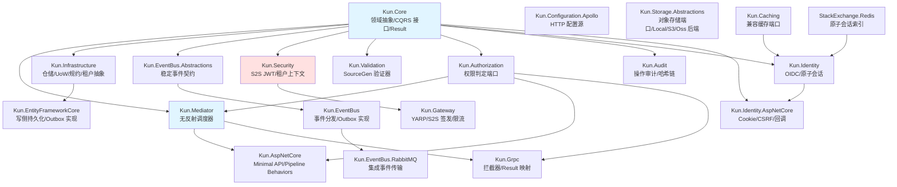

# 模块地图

> **Version**：`0.1.0-phase1`（2026-04-23 发布）。模块清单、主要 API、AOT 状态与测试用例数以该 tag 为准。
> 任何下游仓库对 `Kun.*` 的消费都应以本表为 SoT（Single Source of Truth）。

## Phase 1 模块矩阵

图例：AOT 状态 ✅=项目文件写了 `IsAotCompatible=true`（普通构建就开着裁剪、AOT 与单文件分析器；CI 的 AOT 冒烟宿主 `tests/Kun.AotSmoke` 整体扎根原生发布，ILC 零警告）；⚠️=trim-safe 但非 AOT（见历史文档 [AOT 审计（2026-04-23）](https://github.com/CavaiLAB/kun/blob/51b480775cce05bf889ead14a86749e610503628/docs/architecture/AOT-audit-2026-04-23.md)）。

### Core 层

| 模块 | 职责 | 典型用途 | 主要 API | AOT | 测试 |
|---|---|---|---|:---:|:---:|
| `Kun.Core` | 领域抽象（AggregateRoot / ValueObject / DomainEvent / Result / Error）、`ITenantContext`、`ICurrentUser`、`ISystemClock` | 所有 `Kun.*` 的编译期零依赖基底；下游服务的 DDD 建模直接使用这些类型 | `AggregateRoot<TKey>` / `Result<T>` / `Error` / `ITenantContext` | ✅ | 34 |

### 分发与校验（Abstraction 层）

| 模块 | 职责 | 典型用途 | 主要 API | AOT | 测试 |
|---|---|---|---|:---:|:---:|
| `Kun.Mediator` | `FrozenDictionary` 无反射 CQRS 调度器 + Pipeline Behaviors | 所有业务 Command/Query 的执行入口 | `AddKunMediator(builder => …)` / `ISender` / `IPublisher` | ✅ | 8 |
| `Kun.Validation` | `IValidator<T>` + `ValidationPipelineBehavior` | 命令入口的统一校验 | `AddValidator<T, TValidator>()` | ✅ | 12 |
| `Kun.Infrastructure` | 仓储 / UoW / 规约 / `IProcessedMessageStore` 抽象 | 旧的持久化层契约，EF 侧已不再实现（已禁用，待归档） | `IRepository<T>` / `IUnitOfWork` / `ISpecification<T>` | ✅ | — |
| `Kun.Configuration` | 强类型 Options + DataAnnotations + fail-fast | 下游服务的配置装配 | `AddKunOptions<T>()` | ✅ | 13 |

### 平台端口增量（2026-10-09）

| 模块 | 职责 | 主要 API | AOT |
|---|---|---|---|
| `Kun.Authorization` | 权限判定、数据谓词与字段策略端口，无权限引擎 | `IPermissionChecker`、`IDataPermissionFilter`、`IFieldPolicy` | true，CI 验证 |
| `Kun.Configuration.Apollo` | HTTP 配置源、长轮询、签名和缓存 | `AddApollo`、`ApolloOptions` | true，CI 验证 |

Mediator、ASP.NET Core 和 gRPC 增加对 Authorization 的依赖；具体语义与迁移见 [Kun ADR-016](../adr/kun/ADR-016-platform-ports.md)。历史 Phase 1 表保留为原始版本快照。

### 错误模型合一（S1-KUN-023）

| 模块 | 职责 | 主要 API | AOT |
|---|---|---|---|
| `Kun.Errors` | 错误码与错误码目录、`Error`、`ErrorException`、RFC 9457 problem+json 的 `ErrorDetail`；零依赖 | `ErrorCode`、`ErrorCatalog`、`Error`、`ErrorException`、`PlatformErrors` | true，CI 验证 |
| `Kun.Errors.AspNetCore` | HTTP 错误映射：`ErrorException` 与框架自己产生的错误一律写成 `ErrorDetail` | `AddKunErrors`、`UseKunErrors`、`KunResults.Error` | true，CI 验证 |

`Kun.Core` 的 `Error`、`ErrorType`、`ResultFailureException` 与 `DomainException` 删除，`Result` 失败时带 `Kun.Errors` 的 `Error`；`Kun.Validation` 的 `ValidationError`、`ValidationException` 删除，校验失败给 `INPUT_INVALID` 与逐项字段错误（字段级错误码 + JSON Pointer）；`Kun.AspNetCore` 只做端点映射（`MapCommand`、`MapQuery`），`AddKunAspNetCore`、异常处理器与 `ToProblemDetails` 删除；`Kun.Grpc` 按错误码的 HTTP 状态映射 gRPC 状态码。上面 Phase 1 表里这几行按原样保留。

### 中介登记可叠加（S1-KUN-023）

`AddKunMediator` 可以对同一个服务集合调多次：第一次建 `KunMediatorBuilder` 并登记 `KunMediator`、`ISender`、`IPublisher`，之后的调用往同一个 builder 里加，几个模块各自登记的处理器与行为合进同一个中介。同一请求只能有一个处理器，登记第二个时当场抛 `InvalidOperationException`。`AddPermissionBehavior` 多一个带 `PermissionBehaviorOptions` 的重载，只改这一个请求取权限判定器与当前主体的方式，判定算法与拒绝映射不变。描述符被拷进另一个服务集合时，那个集合另建自己的 builder，不往原来的 builder 里加。权限行为因装配不全（没有判定器、没有权限声明）拒绝时记一条警告日志，与正常的无权分得出来。

### 组件运行时（S1-KUN-023）

| 模块 | 职责 | 主要 API | AOT |
|---|---|---|---|
| `Kun.Runtime` | 组件运行时：插件装载、服务键与注入、类型化事件、可逆副作用、扁平 scope；只引用 `Kun.Errors` | `PluginLoader`、`IPluginContext`、`IKunPlugin`、`KunEvent`、`ScopeKey` | — |

运行时不带产品语义：`ScopeKey` 只查语法（`global`，或小写的种类名加非空 id），种类有哪些由平台档定；声明式表面的目录键 `SurfaceKeys` 在平台档。语言无关的场景用例在 `_import/qian/tck/runtime`，.NET 一侧是 `tests/Kun.Runtime.Tests`。

### 插件开发包（S1-KUN-023）

| 模块 | 职责 | 主要 API | AOT |
|---|---|---|---|
| `Kun.Plugin.Sdk` | 内核档契约：组件的代码声明、生成契约与清单错误、命令策略协议 | `KunPluginAttribute`、`CapabilityAttribute`、`CommandPolicies`、`CommandInvocation` | — |
| `Kun.Plugin.Sdk.Commands` | 平台档契约：能力命令管道（权限、事务、数据会话、主体端口检查）与钩子能力 | `AddKunCapability`、`CommandDataSession<TContext>`、`ExposeCapabilityHook` | — |
| `Kun.Plugin.Sdk.Generators` | 源生成器与 KUNSDK001–003 诊断，只以分析器引用 | — | — |
| `Kun.Plugin.Sdk.AspNetCore` | 平台档契约：HTTP 插件可见性 | `AddKunPluginEndpoints`、`UseKunPluginEndpoints`、`RequireKunPlugin` | — |

清单工具在仓库根的 `tools/Kun.Plugin.Tool`，不打包。`Kun.Plugin.Sdk` 不依赖平台档的包：`CommandInvocation` 带的 `Principal` 在内核契约 `Kun.Security.Abstractions` 里。

### 持久化（Infrastructure 层）

| 模块 | 职责 | 典型用途 | 主要 API | AOT | 测试 |
|---|---|---|---|:---:|:---:|
| `Kun.EntityFrameworkCore` | 写侧 EF Core 实现 + `KunDbContext` + Outbox 落库 + 多租户过滤器 | 所有业务写路径；事务边界与 Outbox 同事务 | `AddKunEntityFrameworkCore()` / `KunDbContext` | ⚠️ trim-safe | — |
| `Kun.Dapper` | 读侧 Dapper AOT 薄包 | 查询 handler 的连接池 + 分页模型 | `IReadDbConnectionFactory` / `PagedResult<T>` | ⚠️ trim-safe | 6 |

`Kun.Dapper` 已归档（S1-KUN-024）：移出解决方案，包名停发。读侧直接用 Npgsql 的数据源与 Dapper（见[读侧模式](../guides/read-side-patterns.md)），分页的请求与结果类型由应用自己定义。上表与下面非 AOT 白名单里的这一行按原样保留。

### 事件与编排

| 模块 | 职责 | 典型用途 | 主要 API | AOT | 测试 |
|---|---|---|---|:---:|:---:|
| `Kun.EventBus.Abstractions` | 稳定事件标记、注册与查询端口 | 只声明事件的契约包 | `IEventTypeRegistrar` / `IIntegrationEvent` | ✅ | 3 |
| `Kun.EventBus` | 集成事件 / Outbox 抽象 + 后台发布器 + 消费端幂等 | 跨服务发布/消费 `*.IntegrationEvent` | `AddKunEventBus(eb => eb.Register<T>("id.v1"))` / `IOutboxWriter` | ✅ | 21 |
| `Kun.EventBus.RabbitMQ` | RabbitMQ broker 适配 + 消费者 + DLQ | 下游服务间事件总线的默认 broker | `AddRabbitMq(...)` / `.Subscribe<TEvent, THandler>()` | ✅ | — |
| `Kun.Saga` | Saga Orchestration（步骤 / 反向补偿 / 超时 / 实例持久化） | 跨服务长事务（下单-支付-发货） | `AddKunSaga()` / `ISagaStep<TContext>` | ⚠️ trim-safe | 18 |

`Kun.Saga` 已归档（S1-KUN-025）：移出解决方案，包名停发，没有替代的包；Order 样例改成不带编排的命令流程。上表与下面非 AOT 白名单里的这一行按原样保留。

### 宿主与通信（Host 层）

| 模块 | 职责 | 典型用途 | 主要 API | AOT | 测试 |
|---|---|---|---|:---:|:---:|
| `Kun.AspNetCore` | Minimal API 扩展 / `MapCommand` / `MapQuery` / 异常处理器 | 下游服务的对外 HTTP 路由 | `AddKunAspNetCore()` / `MapCommand<TReq, TResp>` | ⚠️ trim-safe | 5 |
| `Kun.Grpc` | gRPC 拦截器链（Tracing → Auth → Result 映射） | 服务间内部 RPC；Catalog / Order gRPC endpoint | `AddKunGrpc()` / `KunResultToRpcInterceptor` | ✅ | 7 |
| `Kun.Gateway` | YARP + 外部 JWT 校验 + S2S JWT 签发 + JWKS endpoint + 限流 | 统一边界：外部 JWT 验证 + 内部 S2S JWT 签发 | `AddKunGateway()` / `MapKunJwks()` | ✅ | 21 |

### 安全、多租户、审计

身份平台的四个项目在 `src/` 下。[`Kun.Identity.Abstractions`](../../src/Kun.Identity.Abstractions/README.md) 定义账号与身份连接器端口。[`Kun.Identity.Client`](../../src/Kun.Identity.Client/README.md) 为应用提供 OIDC 登录和服务间令牌校验。[`Kun.Identity.Server`](../../src/Kun.Identity.Server/README.md) 提供账号目录和协议端点，[`Kun.Identity.Connector.Oidc`](../../src/Kun.Identity.Connector.Oidc/README.md) 连接上游身份提供方。

| 模块 | 职责 | 典型用途 | 主要 API | AOT | 测试 |
|---|---|---|---|:---:|:---:|
| `Kun.Security` | S2S JWT 校验 / JWKS 热加载 / `ITenantContext` / `ICurrentUser` 实现 | 每个下游服务都必须装配，验证网关签发的内部 token | `AddKunSecurity()` / `AddKunServiceAuthentication()` | ✅ | 15 |
| `Kun.Security.Abstractions` | 服务间令牌的主体模型与声明词汇表，零依赖 | 公共表面带主体的契约包引用它，不必引用 `Kun.Security` | `Principal` / `PrincipalKind` / `IdentityClaimNames` | ✅ | — |
| `Kun.Identity` | 外部 IdP（OIDC）客户端、JWT 校验与原子会话；**不**自建用户存储 | 账号和凭据由身份权威提供，Kun 负责依赖方校验与会话 | `AddKunIdentity(...)` | ✅ | 11 |
| `Kun.MultiTenancy` | `ITenantContext` 实现 + EF 查询过滤器 + SaveChanges 拦截器 | 所有租户隔离业务的透明过滤 | `AddKunMultiTenancy()` / `UseKunMultiTenancy()` | ✅ | 12 |
| `Kun.MultiTenancy.EntityFrameworkCore` | EF 侧租户过滤器 + `HasTenantFilter<T>()` 扩展 | 与 `Kun.MultiTenancy` 配套的 EF 实现 | `HasTenantFilter<T>()` | ⚠️ trim-safe | — |
| `Kun.Audit` | 审计写入器抽象 + `NullAuditWriter` / `EventBusAuditWriter` | 下游服务的操作审计；通过 Outbox 异步记录 | `AddKunAudit()` / `.UseEventBus()` | ✅ | 13 |
| `Kun.Audit.EntityFrameworkCore` | EF 持久化后端 | 需要审计 on-box 持久化时的可选后端 | `AddKunAuditEntityFrameworkCore()` | ⚠️ trim-safe | — |
| `Kun.RateLimit` | 基于 `.NET 10 RateLimiter` 的按租户分区限流 | Gateway 与业务服务的请求级别保护 | `AddKunRateLimit(...)` | ✅ | 6 |

`Kun.MultiTenancy.EntityFrameworkCore` 已并入 `Kun.EntityFrameworkCore`（S1-KUN-024）：包名停发，EF 侧的租户过滤、租户字段拦截器与模型缓存键在命名空间 `Kun.EntityFrameworkCore.MultiTenancy`，登记扩展在 `Kun.EntityFrameworkCore.DependencyInjection`。上表与下面非 AOT 白名单里的这一行按原样保留。

### 缓存 / 存储 / 观测 / Sandbox

| 模块 | 职责 | 典型用途 | 主要 API | AOT | 测试 |
|---|---|---|---|:---:|:---:|
| `Kun.Caching` | `IKunCache` 抽象 + `MemoryCache` / `StackExchange.Redis` 后端 | 下游服务的热数据缓存（租户映射、Feature flag、Prompt 模板） | `AddKunCaching(c => c.UseMemory() / .UseRedis(…))` | ✅ | 12 |
| `Kun.Storage` | 7-method `IFileStorage` 契约 + 本地磁盘 / S3 两个实现 | 下游服务的文件工件（上传附件、agent 输出、sandbox 产物） | `AddKunStorage().UseLocal(...)` / `.UseS3(...)` | ✅ | 23 |
| `Kun.Observability` | 统一 OTel traces + metrics + logs + 预注册全部 Kun ActivitySource | 所有下游服务用一行装配可观测性 | `AddKunObservability("service-name")` | ✅ | 5 |
| `Kun.Sandbox` | E2B v2 兼容 sandbox 抽象 + `SupervisorSandboxProvider` / `E2BCloudSandboxProvider`（Phase 2+ 占位）/ `InMemorySandboxProvider` | 智能体侧在沙箱里执行 LLM 产出的代码 | `AddKunSandbox(o => o.UseSupervisor / UseE2BCloud / UseInMemory)` | ✅ | 27 |

`Kun.Sandbox` 与旧线的 `Kun.Storage` 已归档（S1-KUN-028）：移出解决方案，包名停发。`Kun.Sandbox` 没有替代的包；对象存储用 `Kun.Storage.Abstractions` 的 `IFileStorage`（命名空间 `Kun.Storage`），后端选 `Kun.Storage.Local`、`Kun.Storage.S3` 或 `Kun.Storage.Oss`。上表里这两行按原样保留。

> **测试列的口径**：统计每个 `tests/Kun.*.Tests` 项目下标记为 `[Fact]` / `[Theory]` 的测试方法数（`grep -c '\[Fact\b\|\[Theory\b'`）。这是"测试用例数"的近似值，不是行覆盖率；行覆盖率请看 CI `coverage.cobertura.xml` 构建产物。单元格内 `—` 表示该模块暂无 `*.Tests` 项目（`Kun.Infrastructure` / `Kun.EntityFrameworkCore` / `Kun.EventBus.RabbitMQ` / `Kun.Audit.EntityFrameworkCore` / `Kun.MultiTenancy.EntityFrameworkCore` — 它们的覆盖由 `Kun.IntegrationTests` / 邻近模块的测试间接覆盖）。

### 非 AOT 白名单（不写 `IsAotCompatible`，有明确原因）

| 模块 | 原因 |
|---|---|
| `Kun.AspNetCore` | Minimal API 泛型帮手（`MapCommand<T,R>`）+ `WriteAsJsonAsync<T>` 不兼容 AOT；trim-safe 即可 |
| `Kun.Dapper` | 薄包装；真正的 AOT 读侧由消费侧 `[DapperAot]` handler 负责 |
| `Kun.EntityFrameworkCore` | `DbContext.Set<T>()` / `MakeGenericMethod` / 非 typed JSON 序列化 |
| `Kun.Audit.EntityFrameworkCore` | 透传 EF Core |
| `Kun.MultiTenancy.EntityFrameworkCore` | 全局查询过滤器使用 `Expression.Property` / `Expression.Lambda` |
| `Kun.Saga` | `Persistence/Ef/` 透传 EF Core；Phase 2 跟进拆分 |
| `Kun.Auditing` | EF 的 SaveChanges 拦截器带出 IL2091；按合并蓝图 D23.9 在 B6 并入平台档的 `Kun.Audit.EntityFrameworkCore` |

## 依赖关系图



## 分层规则

```
┌─────────────────────────────────────────────────────────┐
│  Host Layer                                             │
│  Kun.AspNetCore / Kun.Grpc / Kun.Gateway                │
├─────────────────────────────────────────────────────────┤
│  Infrastructure Layer                                   │
│  Kun.EntityFrameworkCore                                │
│  Kun.EventBus.RabbitMQ / Kun.Storage.*                  │
├─────────────────────────────────────────────────────────┤
│  Abstraction Layer                                      │
│  Kun.Mediator / Kun.Infrastructure                      │
│  Kun.EventBus / Kun.Security / Kun.Validation / Kun.Audit│
├─────────────────────────────────────────────────────────┤
│  Core Layer                                             │
│  Kun.Core (zero dependencies)                           │
└─────────────────────────────────────────────────────────┘
```

## 典型请求调用路径（HTTP → DB → 事件）

```
HTTP Request
    │
    ▼
Kun.Gateway                      [签发 S2S JWT]
    │
    ▼
Kun.AspNetCore / Minimal API     [校验 S2S JWT / 注入 ITenantContext]
    │
    ▼
Kun.Mediator.Send(Command)       [Pipeline: Logging → Validation → Auth → Handler]
    │
    ▼
Command Handler                  [纯 C#，依赖 IRepository<T>]
    │
    ▼
Kun.EntityFrameworkCore          [聚合根 + Outbox 同事务落库]
    │
    ▼
PostgreSQL                       [SaveChanges = 原子事务]
    │
    ▼
Kun.EventBus OutboxPublisher     [扫描 pending 消息 → RabbitMQ]
    │
    ▼
Kun.EventBus.RabbitMQ            [传递 W3C Trace Context]
    │
    ▼
下游服务消费端                    [IdempotentConsumerDecorator → Handler]
```

## 典型查询路径（HTTP → DB 只读）

```
HTTP Request
    │
    ▼
Kun.AspNetCore / Minimal API
    │
    ▼
Kun.Mediator.Send(Query)
    │
    ▼
Query Handler
    │
    ▼
Npgsql 数据源 + Dapper (读侧连接)  [原生 SQL，DTO 投影]
    │
    ▼
PostgreSQL (只读副本 / 读库)
```
